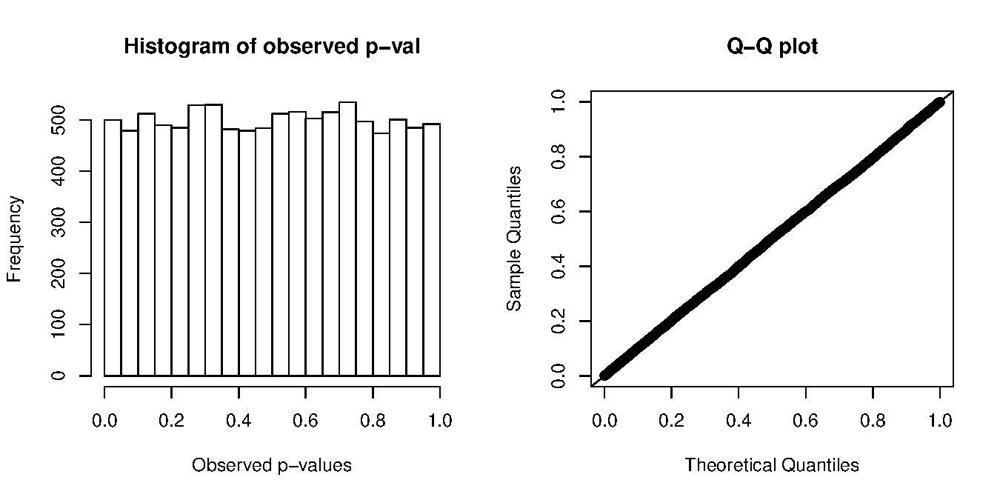
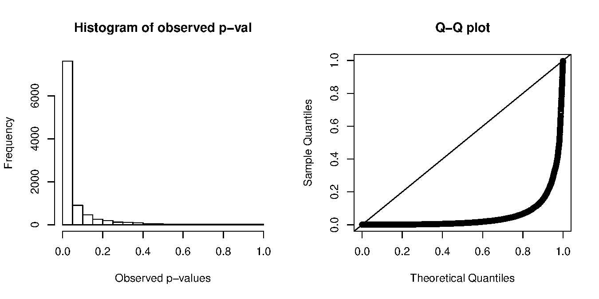
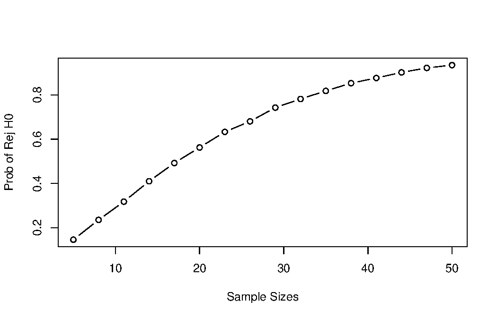
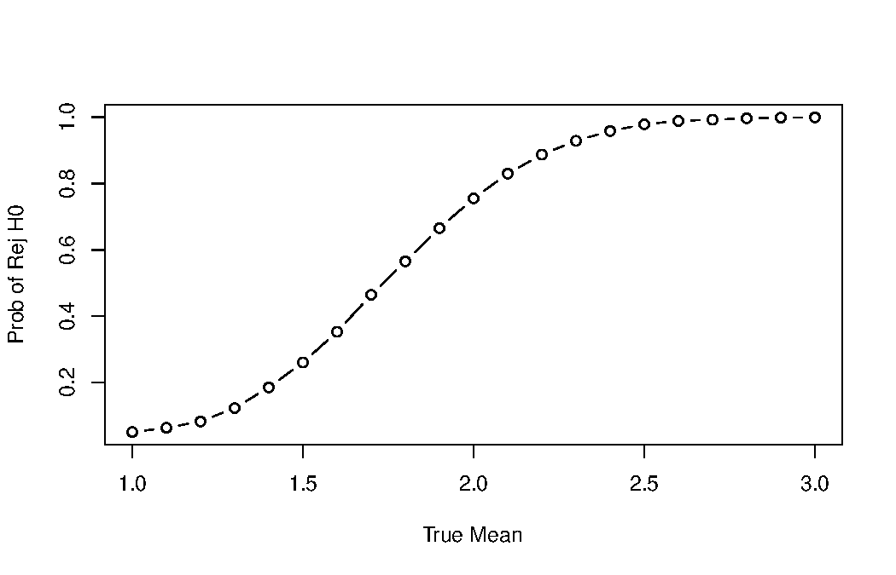
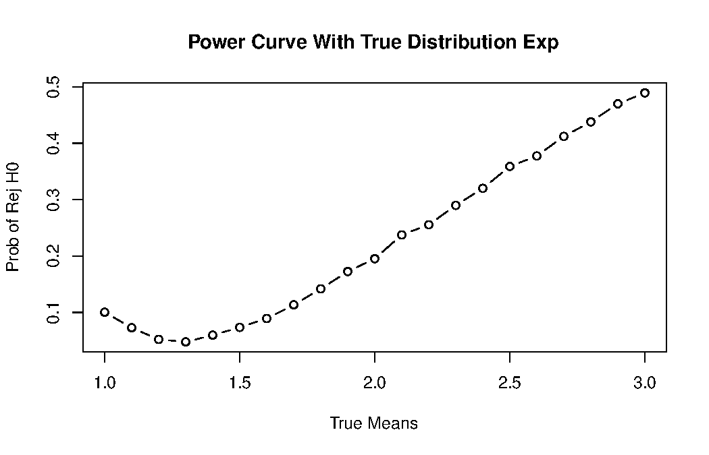



::: {.content-visible when-format="html"}
::: {.page-buttons}
[ PDF](s3p3.pdf){.btn .btn-sm .btn-outline-dark}


<div class="page-codefiles">All code on this page, in one file: </div>
:::

Every code block on this page runs in your browser. Click *Run Code*, change the code,
run it again. The page shares one R session and one Python session, so run the blocks
in order.
:::

## Testing for a population mean

### One-sample hypothesis testing

1.  Let $X_1, \ldots, X_n$ be a random sample from $\mathrm{N}(\mu, \sigma^2)$. Both $\mu$ and $\sigma$ are unknown and $\mu$ is our interest.
2.  Our goal is to test

$$
H_0: \mu = \mu_0 \quad \text{versus} \quad H_1: \mu \neq \mu_0.
$$

3.  We compute a realization of the test statistic

$$
t = \frac{\bar{X} - \mu_0}{S/\sqrt{n}},
$$

The random version $T = (\bar{X} - \mu_0)/(S/\sqrt{n})$ follows $t_{n-1}$ [if $H_0$ is true]{.term}, and $t$ is its observed value.

4.  Reject $H_0$ in favor of $H_1$ when the distance between $\bar{X}$ and $\mu_0$ is large, in the sense that $|t| > t_{\alpha/2, n-1}$.
5.  Our [selected significance level]{.term} is $\alpha$, which equals the [**probability**]{.term} that the event above occurs when $H_0$ is true.

### Interpreting that probability

6.  How to interpret the [**probability**]{.term}?
    -   We treat the sample $X_1, \ldots, X_n$ as a realization from the underlying distribution.
    -   Thus $t$ is a realization of the test statistic $T$, based on the sample drawn from the underlying distribution. $T$ is a yet-to-be-observed (random) variable.
    -   In other words, an independent replication of the experiment would produce a new test statistic realization, say $t'$.
    -   The distribution of $T$ is referred to as the [**sampling distribution**]{.term}.
    -   With the understanding of the underlying distribution and replicated experiments, we see $P(|T| > t_{\alpha/2, n-1}) = \alpha$ when $H_0$ is true.

### Type I error and power

7.  [**Type I error**]{.term} of the test is the probability that $H_0$ is rejected when it is true. In this example, Type I error is $P(|T| > t_{\alpha/2, n-1}) = \alpha$, where $T \sim t_{n-1}$.
8.  The significance level $\alpha$ is most commonly selected as $0.05$.
9.  The [**power**]{.term} of the test is the probability that $H_0$ is rejected when $H_1$ is true. In this example, the power is $P(|T| > t_{\alpha/2, n-1})$ while the distribution of $T$ is **not** $t_{n-1}$. Power is calculated for a specified alternative hypothesis, significance level, and sample size.

### The observed $p$-value

10. The [**observed $p$-value**]{.term} is defined as the probability that an independent replication of this experiment would produce a new test statistic realization, say $t'$, that is as extreme or more extreme than our current realization $t$ is, when $H_0$ is true.
11. "Extremeness" means contradictory to $H_0$ in favor of $H_1$. In this example, extremeness means being further away from zero:

$$
\begin{aligned}
&P(T_\mathrm{new} \le -|t|) + P(T_\mathrm{new} \ge |t|) \\
=\ & \texttt{pt}(-|t|, n-1) + 1 - \texttt{pt}(|t|, n-1)\\
=\ & 2\,\texttt{pt}(-|t|, n-1).
\end{aligned}
$$

**Remark:** `pt` is the R function for the CDF of $t_{n-1}$; `qt` is the R function for the inverse CDF, also called the quantile function.

12. If the observed $p$-value is too small, namely smaller than $\alpha$, then the sample is considered too extreme under $H_0$, and we reject $H_0$.
13. Therefore, the same decision can be made by
    -   $|t| > t_{\alpha/2, n-1}$;
    -   $p$-value: $2\,\texttt{pt}(-|t|, n-1) < \alpha$.

Example: $X_1 \ldots X_{30} \stackrel{\texttt{iid}}{\sim} \mathrm{N}(\mu, \sigma^2)$. Hypothesis: $H_0: \mu = \mu_0$ versus $H_1: \mu \neq \mu_0$.

::: {.panel-tabset}

#### R

```{webr}
set.seed(5400)
n    <- 30   # sample size
mu   <- 1    # true mean
mu_0 <- 1    # mean to be tested
sig  <- 2    # standard deviation
alp  <- 0.05 # significance level
X <- rnorm(n, mu, sig)
```

```{webr}
(t_stat <- (mean(X) - mu_0) / (sd(X) / sqrt(n)))
```

```{webr}
(p_val <- 2 * pt(-abs(t_stat), n - 1))
```

#### Python

```{pyodide}
import numpy as np
import scipy.stats

np.random.seed(5400)
n    = 30
mu   = 1
mu_0 = 1
sig  = 2
alp  = 0.05
X = np.random.normal(mu, sig, n)
```

```{pyodide}
t_stat = (np.mean(X) - mu_0) / (np.std(X, ddof=1) / n**0.5)
print(t_stat)
```

```{pyodide}
p_val = 2 * scipy.stats.t.cdf(-np.abs(t_stat), n - 1)
print(p_val)
```

:::

::: {.callout-warning title="Two common mistakes in the Python version"}
**Both mistakes give a number and no error message.**

```{.python}
t_stat = (np.mean(X) - mu_0) / (np.std(X) / n**0.5)       # wrong: np.std divides by n
p_val = 2 * scipy.stats.t.pdf(-np.abs(t_stat), n - 1)     # wrong: density, not CDF
```

`np.std(X)` divides by $n$, so it is not the $S$ in the $t$ statistic. You need `np.std(X, ddof=1)`, as in the code above.

`scipy.stats.t.pdf` is the **density**, not the CDF. A $p$-value needs `scipy.stats.t.cdf`, or equivalently `2 * scipy.stats.t.sf(abs(t_stat), n-1)`. The density is not a probability, so the second line does not give a $p$-value. For example, at $t = 0$ it gives 0.79, not 1.
:::

### The distribution of the random $p$-value

14. The distribution of the [**random $p$-value**]{.term} can also be studied. The yet-to-be-observed random $p$-value for the one-sample $t$-test with two-sided alternative is the random variable

$$
\begin{aligned}
&P(T_\mathrm{new} \le -|T|) + P(T_\mathrm{new} \ge |T|) \\
=\ & \texttt{pt}(-|T|, n-1) + 1 - \texttt{pt}(|T|, n-1)
=\ 2\,\texttt{pt}(-|T|, n-1).
\end{aligned}
$$

15. Under $H_0$, $T$ follows $t_{n-1}$ and thus $P(2\,\texttt{pt}(-|T|, n-1) \le u) = u$, which implies that the random $p$-value follows $\mathrm{Unif}(0, 1)$ when $H_0$ is true.
16. Thus the probability that an observed $p$-value is less than $\alpha$ is $\alpha$. In other words, Type I error is $\alpha$.

::: {.callout-note collapse="true" title="Proof of item 15"}
**The proof uses the symmetry of the $t$ distribution.**

$$
\begin{aligned}
P(2\,\texttt{pt}(-|T|, n-1) \le u) &= P\left(\texttt{pt}(-|T|, n-1) \le u/2 \right) \\
&= P\left(-|T| \le \texttt{qt}(u/2, n-1)\right) \qquad (\star)\\
&= 2P(T \le \texttt{qt}(u/2, n-1))\\
&= 2\,\texttt{pt}(\texttt{qt}(u/2, n-1), n-1)\\
&= 2u/2 = u.
\end{aligned}
$$

To see $(\star)$, let $x = \texttt{qt}(u/2, n-1)$. We see $x \le 0$ because $u \le 1$. It holds that

$$
P(-|T| \le x) = P(|T| \ge -x) = P(T \ge -x) + P(T \le x) = 2P(T \le x).
$$
:::

So for this $t$-test under the normal model, the random $p$-value is $\mathrm{Unif}(0, 1)$ when $H_0$ is true. The simulation below checks this. Note that a $p$-value is not the probability that $H_0$ is true.

### Plan for the simulation

With the help of simulations, our goals are to

-   check the distribution of $p$-values,
-   check the Type I error and power under different settings.

We now focus on the first goal. First, let us generate the distribution of $p$-values, with the following steps.

-   Repeat:
    1.  generate $X_1 \ldots X_n$;
    2.  compute the sample mean $\bar{X}$;
    3.  compute the sample standard deviation $S$;
    4.  compute the $t$-statistic;
    5.  compute the (observed) $p$-value.

Second, we check the distributions of the generated (observed) $p$-values.

### The function `pvalDist`

::: {.panel-tabset}

#### R

```r
#' Simulation of p-values
#'
#' The function is used to simulate
#'   the distribution of observed p-values
#' arguments:
#' @param n      sample size
#' @param mu     true mean
#' @param mu_0   mean to be tested
#' @param sig    true standard deviation
#' @param alp    significance level, default is 0.05
#' @param B      simulation size, default is 10000
#' @return
#' a vector of observed pvals
```

#### Python

```python
"""Simulation of p-values

The function is used to simulate
  the distribution of observed p-values

Parameters
    n      sample size
    mu     true mean
    mu_0   mean to be tested
    sig    true standard deviation
    alp    significance level, default is 0.05
    B      simulation size, default is 10000
Returns
    a list of observed pvals
"""
```

:::

::: {.panel-tabset}

#### R

```{webr}
pvalDist <- function(n, mu, mu_0, sig, alp = 0.05, B = 10000) {
  # step 1: generate samples
  Xlist <- matrix(rnorm(B * n, mu, sig), B, n)
  # step 2: compute sample mean
  Xbarlist <- rowMeans(Xlist)
  # step 3: compute sample standard deviation
  sdlist <- apply(Xlist, 1, sd)
  # step 4: compute t-statistic
  t_stat <- (Xbarlist - mu_0) / (sdlist / sqrt(n))
  # step 5: compute the (observed) p-value
  pvals <- 2 * pt(-abs(t_stat), n - 1)

  return(pvals)
}
```

#### Python

```{pyodide}
def pvalDist(n, mu, mu_0, sig, alp=0.05, B=10000):
    Xlist = [np.random.normal(mu, sig, n) for i in range(B)]
    Xbarlist = np.mean(Xlist, 1)
    Slist = np.std(Xlist, 1, ddof=1)
    t_stat_list = (Xbarlist - mu_0) / (Slist / n**0.5)
    pvals = 2 * scipy.stats.t.sf(np.abs(t_stat_list), n - 1)   # all B p-values at once
    return pvals
```

:::

::: {.callout-note collapse="true" title="Going further: a scoping bug in R"}
**A typo in an argument name can give no error.** The version below names the argument `mu0` but uses `mu_0` inside the body.

::: {.panel-tabset}

#### R

```{.r}
pvalDist <- function(n, mu, mu0, sig, alp = 0.05, B = 10000) {
  Xlist <- matrix(rnorm(B * n, mu, sig), B, n)
  t_stat <- (rowMeans(Xlist) - mu_0) / (apply(Xlist, 1, sd) / sqrt(n))   # mu_0, not mu0
  2 * pt(-abs(t_stat), n - 1)
}
```

#### Python

```{.python}
# Python has the same problem: it also finds the global mu_0, with no error
def pvalDist(n, mu, mu0, sig, alp=0.05, B=10000):
    Xlist = np.random.normal(mu, sig, (B, n))
    t_stat = (np.mean(Xlist, 1) - mu_0) / (np.std(Xlist, 1, ddof=1) / n**0.5)   # mu_0, not mu0
    return 2 * scipy.stats.t.cdf(-np.abs(t_stat), n - 1)
```

:::

R gives no error. It does not find `mu_0` inside the function, so it looks in the global environment and uses the `mu_0` you defined earlier. The function then ignores the argument `mu0` that you passed. If there is no `mu_0` in the global environment either, R gives an error.

So a typo can make your function depend on objects in your workspace. Then the function may work in your session but fail on another computer. Run your script in a fresh R session to check it. Section 2.3 explains how R looks for variables outside a function, with the example `y <<- y + 1`.
:::

### Type I error when $H_0$ is true

::: {.panel-tabset}

#### R

```{webr}
# Simulation on Type I error when H0 is true
set.seed(5400)
n   <- 30
mu  <- 1
sig <- 2
alp <- 0.05

# H_0 is true
mu_0 <- 1

pvals <- pvalDist(n, mu, mu_0, sig, alp)
```

```{webr}
# Type I error
mean(pvals < alp)
```

#### Python

```{pyodide}
np.random.seed(5400)
n    = 30
mu   = 1
mu_0 = 1
sig  = 2
alp  = 0.05

pvals = pvalDist(n, mu, mu_0, sig, alp)
print(np.mean([pvals[i] < alp for i in range(10000)]))
```

:::

::: {.panel-tabset}

#### R

```{webr}
# Q-Q plot for uniform distribution
qqunif <- function(dat, ...) {
  probs <- ppoints(length(dat))
  plot(qunif(probs), sort(dat),
    xlab = "Theoretical Quantiles",
    ylab = "Sample Quantiles",
    main = "Q-Q plot", ...)
  abline(0, 1)
}
```

```{webr}
# Histogram and Q-Q plot for observed p-value
par(mfrow = c(1, 2))
hist(pvals,
  main = "Histogram of observed p-val",
  xlab = "Observed p-values")
qqunif(pvals)
```

#### Python

```{pyodide}
import matplotlib.pyplot as plt

# Q-Q plot for uniform distribution
def qqunif(dat, **kwargs):
    probs = (np.arange(1, len(dat) + 1) - 0.5) / len(dat)   # ppoints(length(dat))
    plt.plot(scipy.stats.uniform.ppf(probs), np.sort(dat), 'o', mfc='none', **kwargs)
    plt.xlabel("Theoretical Quantiles")
    plt.ylabel("Sample Quantiles")
    plt.title("Q-Q plot")
    plt.plot([0, 1], [0, 1], 'k-')                          # abline(0, 1)
```

```{pyodide}
# Histogram and Q-Q plot for observed p-value
plt.figure(figsize=(10, 4))
plt.subplot(1, 2, 1)
plt.hist(pvals, edgecolor='black')
plt.title("Histogram of observed p-val")
plt.xlabel("Observed p-values")
plt.subplot(1, 2, 2)
qqunif(pvals)
plt.show()
```

:::

{width="78%" fig-align="center"}

The histogram is flat, and the Q-Q plot is a straight line. So under $H_0$ the $p$-value is uniform, as item 15 says.

### Application: trying many prompts and keeping the best

-   A prompt is the text we send to the model. We write 20 versions of a prompt and test each one against a baseline prompt. Suppose none of them is truly better than the baseline.
-   Then each $p$-value follows $\mathrm{Unif}(0, 1)$ (item 15). So each test still has a 5% chance to give $p < 0.05$, just by luck.
-   We keep the best prompt, namely the one with the smallest $p$-value. With $K$ independent tests,

$$
P\left(\min(U_1, \ldots, U_K) < 0.05\right) = 1 - 0.95^K.
$$

-   When $K = 20$, this probability is about 0.64. The best prompt looks significant in 64% of cases, although no prompt is better.
-   This is the problem of [**multiple comparisons**]{.term}: when we run many tests, some small $p$-values appear by chance.

::: {.panel-tabset}

#### R

```{webr}
set.seed(5400)
K <- c(1, 5, 20)
sapply(K, function(k) mean(replicate(5000, min(runif(k))) < 0.05))
1 - 0.95^K
```

#### Python

```{pyodide}
np.random.seed(5400)
K = [1, 5, 20]
print([np.mean(np.random.rand(5000, k).min(axis=1) < 0.05) for k in K])
print([1 - 0.95**k for k in K])
```

:::

Now we look at a concrete case. Each of 20 prompts is scored on its own 200 questions, and every prompt is truly 70% accurate. We test each prompt against the known value 0.70 with the normal approximation, so the $p$-values are approximate.

::: {.panel-tabset}

#### R

```{webr}
set.seed(5400)
K <- 20; n <- 200
acc <- rbinom(K, n, 0.70) / n                          # observed accuracy of each prompt
max(acc)                                               # the best-looking prompt
1 - pnorm((max(acc) - 0.70) / sqrt(0.70 * 0.30 / n))   # its one-sided p-value
rbinom(1, n, 0.70) / n                                 # the same prompt on 200 new questions
```

#### Python

```{pyodide}
np.random.seed(5400)
K = 20; n = 200
acc = np.random.binomial(n, 0.70, K) / n               # observed accuracy of each prompt
print(acc.max())                                       # the best-looking prompt
print(1 - scipy.stats.norm.cdf((acc.max() - 0.70) / np.sqrt(0.70 * 0.30 / n)))
print(np.random.binomial(n, 0.70) / n)                 # the same prompt on 200 new questions
```

:::

[ Predict]{.mode}: in R, the best prompt scores 0.765 with $p \approx 0.02$. What will it score on 200 new questions?

::: {.callout-note collapse="true" title="Answer"}
**About 0.70, like every other prompt.** In R it scores 0.69. It was chosen because it was lucky on the first 200 questions. On new questions it has no such advantage. Averaged over many repetitions, the best of 20 prompts scores about 0.76 on the questions it was chosen on.

There are three standard fixes:

-   Compare the smallest $p$-value with $0.05/K$ (Bonferroni). Then $P(\min U_k < 0.05/K) \le 0.05$, even when the $p$-values are dependent.
-   If several prompts may truly help and you want to find them, control the false discovery rate, which is the expected fraction of false rejections among all rejections. With independent $p$-values, the procedure of Benjamini and Hochberg (1995) does this.
-   Choose the prompt on one set of questions and report its accuracy on a separate set that was not used for the choice.

Sclar et al. (2024) found that changing only the format of a prompt (spacing, separators) changed accuracy by up to 76 percentage points, for one model on one task. Because small format changes can matter this much, it is easy to try many versions of a prompt and keep the best one.
:::

References:

-   Simmons, Nelson, and Simonsohn (2011) [*False-Positive Psychology: Undisclosed Flexibility in Data Collection and Analysis Allows Presenting Anything as Significant*](https://doi.org/10.1177/0956797611417632). **Psychological Science**. 22(11). 1359--1366.
-   Benjamini and Hochberg (1995) [*Controlling the False Discovery Rate: A Practical and Powerful Approach to Multiple Testing*](https://doi.org/10.1111/j.2517-6161.1995.tb02031.x). **Journal of the Royal Statistical Society: Series B**. 57(1). 289--300.
-   Sclar, Choi, Tsvetkov, and Suhr (2024) [*Quantifying Language Models' Sensitivity to Spurious Features in Prompt Design*](https://arxiv.org/abs/2310.11324). **ICLR 2024**.

### Power when $H_0$ is false

Now suppose $H_0$ is false. Let the true mean be $\mu = 2$, and we test $H_0: \mu = 1$, that is, $\mu_0 = 1$.

::: {.panel-tabset}

#### R

```{webr}
# Simulation on the power when H0 is false
set.seed(5400)
n   <- 30
mu  <- 2
sig <- 2
alp <- 0.05

# H_0 is false
mu_0 <- 1

pvals2 <- pvalDist(n, mu, mu_0, sig, alp)
```

```{webr}
# power
mean(pvals2 < alp)
```

```{webr}
par(mfrow = c(1, 2))
hist(pvals2,
  main = "Histogram of observed p-val",
  xlab = "Observed p-values")
qqunif(pvals2)
```

#### Python

```{pyodide}
np.random.seed(5400)
n    = 30
mu   = 2
mu_0 = 1
sig  = 2
alp  = 0.05

pvals2 = pvalDist(n, mu, mu_0, sig, alp)
print(np.mean([pvals2[i] < alp for i in range(10000)]))
```

```{pyodide}
plt.figure(figsize=(10, 4))
plt.subplot(1, 2, 1)
plt.hist(pvals2, edgecolor='black')
plt.title("Histogram of observed p-val")
plt.xlabel("Observed p-values")
plt.subplot(1, 2, 2)
qqunif(pvals2)
plt.show()
```

:::

{width="78%" fig-align="center"}

Now many more $p$-values are near zero. The estimated power is the fraction of $p$-values below $\alpha$.

### Power curve under different sample sizes

::: {.panel-tabset}

#### R

```{webr}
set.seed(5400)
mu  <- 2
sig <- 2
alp <- 0.05
# H_0 is false
mu_0  <- 1
nlist <- seq(5, 50, 3)
rejprobs <- rep(NA, length(nlist))
for (i in seq_along(nlist)) {
  rejprobs[i] <- mean(pvalDist(nlist[i],
    mu, mu_0, sig, alp, B = 2000) < alp)
} # or use the sapply function
```

```{webr}
plot(y = rejprobs, x = nlist, type = "b",
  xlab = "Sample Sizes", ylab = "Prob of Rej H0")
```

#### Python

```{pyodide}
np.random.seed(5400)
mu   = 2
mu_0 = 1
sig  = 2
alp  = 0.05

# compute the rejection probs
x = list(range(5, 51, 3))
rejprobs = [None] * len(x)

for i in range(len(x)):
    pvals = pvalDist(x[i], mu, mu_0, sig, alp, B=2000)
    rejprobs[i] = np.mean([p < alp for p in pvals])
```

```{pyodide}
import matplotlib.pyplot as plt

plt.plot(x, rejprobs, '-o')
plt.xlabel("Sample Sizes")
plt.ylabel("Prob of Rej H0")
plt.show()
```

:::

{width="62%" fig-align="center"}

We use `B = 2000` so that the code runs fast in the browser. With `B = 10000` (try it on your own computer), the curve is smoother. The ups and downs are simulation error, not a feature of the power function. The last section of this page, Number of replicates, studies this error.

### Power curve under different true means

[ By hand]{.mode}: fill in the `sapply` so that the true mean varies while $\mu_0$ stays at 1. You are done when the curve starts near 0.05 and rises toward 1. No AI for this block.

::: {.panel-tabset}

#### R

```{webr}
set.seed(5400)
n <- 30
mulist <- seq(1, 3, 0.1)
sig <- 2
alp <- 0.05
mu_0 <- 1

rejprobs <- rep(0.5, length(mulist))     # <- change this line

plot(y = rejprobs, x = mulist, type = "b",
  xlab = "True Mean", ylab = "Prob of Rej H0")
```

#### Python

```{pyodide}
np.random.seed(5400)
n      = 30
mulist = np.linspace(1, 3, 21)           # seq(1, 3, 0.1)
sig    = 2
alp    = 0.05
mu_0   = 1

rejprobs = [0.5] * len(mulist)           # <- change this line (a list comprehension)

plt.plot(mulist, rejprobs, '-o')
plt.xlabel("True Mean")
plt.ylabel("Prob of Rej H0")
plt.show()
```

:::

{width="62%" fig-align="center"}

### Application: detecting text from a watermarked model

-   A [**watermark**]{.term} is a hidden statistical signal that a model puts into its text.
-   We follow the scheme of Kirchenbauer et al. (2023). Before writing each token (a word piece), the model uses a secret key and the previous token to split its vocabulary into a "green" half and a "red" half. It then slightly prefers green tokens.
-   Text without the watermark, for example text written by a person, does not follow the key. In our simulation, each of its tokens is green with probability $\gamma = 0.5$, independently of the other tokens. Real text can break this assumption, for example when the same phrase repeats.
-   For a text of $T$ tokens with $G$ green ones, we test $H_0$: the text is not watermarked, versus $H_1$: it is. The test statistic is

$$
z = \frac{G - \gamma T}{\sqrt{T \gamma (1-\gamma)}},
$$

and the text is flagged as watermarked if $z > 4$.

-   A Type I error here means flagging text without a watermark, such as a student's own essay. With the normal approximation, the threshold 4 gives a Type I error of about $1 - \Phi(4) \approx 3 \times 10^{-5}$.

::: {.panel-tabset}

#### R

```{webr}
wm_z <- function(green, gamma = 0.5) {     # green: one 0/1 entry per token
  T <- length(green)
  (sum(green) - gamma * T) / sqrt(T * gamma * (1 - gamma))
}
set.seed(5400)
human <- rbinom(100, 1, 0.5)    # 100 tokens written by a person
model <- rbinom(100, 1, 0.7)    # 100 tokens from a watermarked model: 70% green
c(human = wm_z(human), model = wm_z(model))
1 - pnorm(4)                    # Type I error of the rule z > 4
```

#### Python

```{pyodide}
def wm_z(green, gamma=0.5):                # green: one 0/1 entry per token
    T = len(green)
    return (green.sum() - gamma * T) / np.sqrt(T * gamma * (1 - gamma))

np.random.seed(5400)
human = np.random.binomial(1, 0.5, 100)   # 100 tokens written by a person
model = np.random.binomial(1, 0.7, 100)   # 100 tokens from a watermarked model: 70% green
print(wm_z(human), wm_z(model))
print(1 - scipy.stats.norm.cdf(4))        # Type I error of the rule z > 4
```

:::

Here we assume the watermark makes 70% of the tokens green. The real share depends on the model and the text. The power of the test depends on the length $T$ of the text, just as the power of the $t$-test depends on $n$.

::: {.panel-tabset}

#### R

```{webr}
set.seed(5400)
Tlist <- seq(10, 300, 10)
power <- sapply(Tlist, function(T) {
  G <- rbinom(2000, T, 0.7)                    # green counts of 2000 watermarked texts
  mean((G - 0.5 * T) / sqrt(T * 0.25) > 4)
})
plot(Tlist, power, type = "b",
  xlab = "Number of tokens", ylab = "Prob of detecting the watermark")
```

#### Python

```{pyodide}
np.random.seed(5400)
Tlist = np.arange(10, 301, 10)
power = [np.mean((np.random.binomial(T, 0.7, 2000) - 0.5 * T) / np.sqrt(T * 0.25) > 4)
         for T in Tlist]
plt.plot(Tlist, power, '-o')
plt.xlabel("Number of tokens"); plt.ylabel("Prob of detecting the watermark")
plt.show()
```

:::

[ Predict]{.mode}: how many tokens does a watermarked text need before the test detects it most of the time?

::: {.callout-note collapse="true" title="Answer"}
**With 70% green tokens, about 100 tokens give power 0.5, and about 200 give power 0.95.** In this example, the test has low power for a text of one or two sentences.

Under $H_1$, $E(z) = (0.7 - 0.5)\sqrt{T}/0.5 = 0.4\sqrt{T}$, which reaches the threshold 4 at $T = 100$. The expected test statistic grows like $\sqrt{T}$, just as $(\mu - \mu_0)/(\sigma/\sqrt{n})$ grows like $\sqrt{n}$ in the $t$-test.

Li et al. (2025) develop a statistical framework for such tests. Dathathri et al. (2024) describe SynthID-Text, a watermark that Google reported using in its Gemini models.
:::

References:

-   Kirchenbauer, Geiping, Wen, Katz, Miers, and Goldstein (2023) [*A Watermark for Large Language Models*](https://arxiv.org/abs/2301.10226). **ICML 2023**. PMLR 202. 17061--17084.
-   Li, Ruan, Wang, Long, and Su (2025) [*A Statistical Framework of Watermarks for Large Language Models: Pivot, Detection Efficiency and Optimal Rules*](https://doi.org/10.1214/24-AOS2468). **Annals of Statistics**. 53(1). 322--351.
-   Dathathri et al. (2024) [*Scalable Watermarking for Identifying Large Language Model Outputs*](https://doi.org/10.1038/s41586-024-08025-4). **Nature**. 634. 818--823.

### Model assumptions

Question: Why does $T = (\bar{X} - \mu)/ (S / \sqrt{n})$ follow $t_{n-1}$?

Answer: Student's theorem. If $X_1, \ldots, X_n \stackrel{\mathrm{iid}}{\sim} \mathrm{N}(\mu, \sigma^2)$, then

1.  $(\bar{X} - \mu)/(\sigma/\sqrt{n}) \sim \mathrm{N}(0, 1)$;
2.  $(n-1)S^2/\sigma^2 \sim \chi^2_{n-1}$;
3.  $\bar{X}$ and $S^2$ are independent.

Recall the $t$-distribution: $Z/\sqrt{X/v}\sim t_{v}$, where $Z\sim \mathrm{N}(0,1)$, $X\sim \chi^2_v$, and $Z$, $X$ are independent.

[**Model assumption**]{.term}: $X_1, \ldots, X_n \stackrel{\mathrm{iid}}{\sim} \mathrm{N}(\mu, \sigma^2)$.

-   Violation of normality.
-   Violation of independence (homework problem).

### What breaks when normality fails

Suppose $X_1, \ldots, X_n \stackrel{\mathrm{iid}}{\sim} \exp(2)$. Test $H_0: \mu = 2$ versus $H_1: \mu \neq 2$.

::: {.panel-tabset}

#### R

```{webr}
pvalDistExp <- function(n, mu, mu_0, alp = 0.05, B = 10000) {
  # simulate data from exp dist
  Xlist <- rexp(B * n, rate = 1/mu)
  Xlist <- matrix(Xlist, B, n)
  Xbarlist <- rowMeans(Xlist)
  sdlist <- apply(Xlist, 1, sd)
  t_stat <- (Xbarlist - mu_0) / (sdlist / sqrt(n))

  # returns observed p-value
  2 * pt(-abs(t_stat), n - 1)
}
```

```{webr}
set.seed(5400)
r1 <- pvalDistExp(10, mu = 2, mu_0 = 2)
# Type I error
mean(r1 < alp)
```

#### Python

```{pyodide}
def pvalDistExp(n, mu, mu_0, alp=0.05, B=10000):
    Xlist = [np.random.exponential(mu, n) for i in range(B)]
    Xbarlist = np.mean(Xlist, 1)
    Slist = np.std(Xlist, 1, ddof=1)
    t_stat_list = (Xbarlist - mu_0) / (Slist / (n**0.5))
    return 2 * scipy.stats.t.sf(np.abs(t_stat_list), n - 1)    # all B p-values at once
```

```{pyodide}
np.random.seed(5400)
r1 = pvalDistExp(10, mu=2, mu_0=2)
print(np.mean([p < 0.05 for p in r1]))
```

:::

The Type I error is about 0.10, not the intended 0.05. For this exponential population and this sample size, the $t$ distribution is not a good reference distribution. We can see this problem easily with a simulation like this one.

### A generic version

[**Goal**]{.term}: write a generic function `pvalDist2` to generate power under mis-specified distributions.

::: {.panel-tabset}

#### R

```r
#' Simulation of p-values
#'
#' The function simulates the observed p-values
#'   under different underlying distributions
#'
#' @param n      sample size
#' @param dist   norm, exp, unif, gamma, etc
#' @param mu_0   mean to be tested
#' @param alp    significance level, default is 0.05
#' @param B      simulation size, default is 10000
#' @param ...    args passed to the dist function
#' @return
#' a vector of observed pvals
```

#### Python

```python
"""Simulation of p-values

The function simulates the observed p-values
  under different underlying distributions

Parameters
    n         sample size
    dist      normal, exponential, uniform, gamma, etc (names in np.random)
    mu_0      mean to be tested
    alp       significance level, default is 0.05
    B         simulation size, default is 10000
    **kwargs  args passed to the dist function
Returns
    a list of observed pvals
"""
```

:::

::: {.panel-tabset}

#### R

```{webr}
pvalDist2 <- function(n, dist, mu_0, alp = 0.05, B = 10000, ...) {
  # simulate data from user-specified dist
  Xlist <- do.call(paste0("r", dist), list(B * n, ...))
  Xlist <- matrix(Xlist, B, n)

  # compute t-statistic for each sample
  Xbarlist <- rowMeans(Xlist)
  sdlist <- apply(Xlist, 1, sd)
  t_stat <- (Xbarlist - mu_0) / (sdlist / sqrt(n))

  # returns observed p-value
  pt(-abs(t_stat), n - 1) + 1 - pt(abs(t_stat), n - 1)
}
```

```{webr}
set.seed(5400)
r2 <- pvalDist2(10, "exp", mu_0 = 2, alp = alp, rate = 1/2)
# Type I error
mean(r2 < alp)
```

#### Python

```{pyodide}
def pvalDist2(n, dist, mu_0, alp=0.05, B=10000, **kwargs):
    rng = getattr(np.random, dist)
    Xlist = [rng(size=n, **kwargs) for i in range(B)]
    Xbarlist = np.mean(Xlist, 1)
    Slist = np.std(Xlist, 1, ddof=1)
    t_stat_list = (Xbarlist - mu_0) / (Slist / (n**0.5))
    return 2 * scipy.stats.t.sf(np.abs(t_stat_list), n - 1)    # all B p-values at once
```

```{pyodide}
np.random.seed(5400)
r2 = pvalDist2(10, "exponential", mu_0=2, scale=2)
print(np.mean([p < 0.05 for p in r2]))
```

:::

::: {.callout-note collapse="true" title="Going further: how the two languages dispatch on a name"}
**R builds the function name as a string. Python looks up the function by its name.**

R's `do.call(paste0("r", dist), list(...))` builds the name `"rexp"` and calls whatever function has that name. This works because R's distribution functions follow the `r`/`d`/`p`/`q` prefix convention. For the same reason, a typo gives you `could not find function "rexpo"` when you call the function, not when you define it.

Python's `getattr(np.random, dist)` looks up a function in `np.random` by its name. A common alternative is `eval`, which runs any string as Python code. Use `getattr` here, so that the string can only name a function.

Both are examples of **metaprogramming**, where a program works with code as data. For R, see the chapter in [Advanced R](https://adv-r.hadley.nz/metaprogramming.html).
:::

[ By hand]{.mode}: fill in the `sapply` to draw the power curve when the true distribution is exponential. You are done when the curve rises from left to right. No AI for this block.

::: {.panel-tabset}

#### R

```{webr}
set.seed(5400)
n <- 10
mulist <- seq(1, 3, 0.1)
alp  <- 0.05
mu_0 <- 1

rejprobs <- rep(0.5, length(mulist))     # <- change this line

plot(y = rejprobs, x = mulist, type = "b",
  xlab = "True Means", ylab = "Prob of Rej H0",
  main = "Power Curve With True Distribution Exp")
```

#### Python

```{pyodide}
np.random.seed(5400)
n      = 10
mulist = np.linspace(1, 3, 21)           # seq(1, 3, 0.1)
alp    = 0.05
mu_0   = 1

rejprobs = [0.5] * len(mulist)           # <- change this line (a list comprehension)

plt.plot(mulist, rejprobs, '-o')
plt.xlabel("True Means")
plt.ylabel("Prob of Rej H0")
plt.title("Power Curve With True Distribution Exp")
plt.show()
```

:::

{width="62%" fig-align="center"}

## Number of replicates

### How accurate is a simulated proportion?

-   We aim to design simulations to study $\theta$, the [**power**]{.term} of a one-sample $t$-test for the distribution mean with two-sided alternative and sample size $n$.
-   Let $T$ be the test statistic. The true power is a proportion:

$$
\theta = P(|T|>t_{\alpha/2, n-1}) = \mathrm{E}[I(|T|>t_{\alpha/2, n-1})].
$$

-   If we generate a random sample and run simulations to estimate the power, this random sample leads to a realization of $Y = I(|T|>t_{\alpha/2, n-1})$.
-   By generating $B$ random samples in our simulations, we have $B$ independent copies of $Y$, denoted $Y_1, \ldots, Y_B$.
-   Our estimate of the [**power $\theta=\mathrm{E}(Y)$**]{.term} is $\bar{Y} = \sum_{b=1}^B Y_b/B$, and

$$
\bar{Y} \text{ approximately follows } \mathrm{N}\left(\theta, \frac{\theta(1-\theta)}{B}\right)
$$

as $B$ is sufficiently large.

-   Thus

$$
1 - \alpha \approx P\left(-z_{\alpha/2} < \frac{\bar{Y}-\theta}{\sqrt{\theta(1-\theta)/B}}< z_{\alpha/2} \right).
$$

We may construct any of the six intervals of Section 3.2 for $\theta$, such as the Wald, simple conservative, score, or Clopper-Pearson interval. Here we apply them to our own simulation output.

### Choosing $B$

-   The margin of error is

$$
m = z_{\alpha/2} \sqrt{\frac{\theta(1-\theta)}{B}}.
$$

-   If we want the margin of error of the $99\%$ interval for the power $\theta$ to be at most $m$, then we need

$$
B \ge \left( \frac{z_{0.005} \sqrt{\theta(1-\theta)}}{m} \right)^2.
$$

-   If we knew that the power $\theta \in (0.8, 1)$, then $\sqrt{\theta(1-\theta)} \le \sqrt{0.8 \times 0.2}$, so we would need

$$
B \ge \left( \frac{z_{0.005} \sqrt{0.8 \times 0.2}}{m} \right)^2.
$$

-   If we have no information on the power $\theta$, then we use $\sqrt{\theta(1-\theta)} \le 0.5$, so we need

$$
B \ge \left( \frac{z_{0.005} \times 0.5}{m} \right)^2.
$$

We next run two simulation examples to estimate the Type I error of the one-sample $t$-test and give confidence intervals of the Type I error.

-   [**Example 1**]{.term}: the true distribution is the normal distribution.
-   [**Example 2**]{.term}: the true distribution is the exponential distribution, so we expect the Type I error is not equal to $\alpha$.

### Example 1: normal distribution

Consider $X_1, \ldots, X_{30} \stackrel{\mathrm{iid}}{\sim} \mathrm{N}(\mu, \sigma^2)$, where $\mu=1$ and $\sigma^2=4$.

-   Hypothesis: $H_0: \mu = 1$ versus $H_1: \mu \neq 1$.
-   $t$-test: reject $H_0$ if the $p$-value $< 0.05$.

::: {.panel-tabset}

#### R

```{webr}
set.seed(5400)
mu <- mu_0 <- 1 # H0 is true
n <- 30; sig <- 2; alp <- 0.05
pval <- pvalDist(n, mu, mu_0, sig, alp = alp, B = 10000)
(theta_est <- mean(pval < alp))
```

#### Python

```{pyodide}
np.random.seed(5400)
mu = mu_0 = 1 # H0 is true
n = 30; sig = 2; alp = 0.05
pval = pvalDist(n, mu, mu_0, sig, alp=alp, B=10000)
theta_est = np.mean(np.array(pval) < alp)
print(theta_est)
```

:::

Is the estimate accurate? For example, is the width of the 95% conservative CI less than 0.01?

::: {.panel-tabset}

#### R

```{webr}
# 95% simple conservative CI
moe <- qnorm(0.975) * 0.5 / sqrt(10000)
(CI <- theta_est + moe * c(-1, 1))
diff(CI)
```

#### Python

```{pyodide}
# 95% simple conservative CI
moe = scipy.stats.norm.ppf(0.975) * 0.5 / np.sqrt(10000)
CI = theta_est + moe * np.array([-1, 1])
print(CI)
print(np.diff(CI))
```

:::

How many replicates do we need to estimate the Type I error rate so that the width of the 95% conservative CI is less than 0.01?

::: {.panel-tabset}

#### R

```{webr}
set.seed(5400)
mu <- mu_0 <- 1 # H0 is true
n <- 30; sig <- 2; alp <- 0.05
m <- 0.005  # moe of 95% CI is at most m
# replicates
(B <- ceiling((qnorm(0.975) * 0.5 / m)^2))
```

#### Python

```{pyodide}
np.random.seed(5400)
mu = mu_0 = 1 # H0 is true
n = 30; sig = 2; alp = 0.05
m = 0.005   # moe of 95% CI is at most m
# replicates
B = int(np.ceil((scipy.stats.norm.ppf(0.975) * 0.5 / m)**2))
print(B)
```

:::

Let us estimate the Type I error rate again with 38415 replicates. The browser uses $B = 10000$ so that the code runs fast. On your own computer, delete the line `B <- 10000` to use all 38415.

::: {.panel-tabset}

#### R

```{webr}
B <- 10000   # 38415 is slow in the browser; delete this line on your own computer
pval <- pvalDist(n, mu, mu_0, sig, alp = alp, B = B)
# estimated Type I error rate
(theta_est <- mean(pval < alp))
```

```{webr}
# 95% simple conservative CI
moe <- qnorm(0.975) * 0.5 / sqrt(B)
(CI <- theta_est + moe * c(-1, 1))
diff(CI)
```

#### Python

```{pyodide}
B = 10000   # 38415 is slow in the browser; delete this line on your own computer
pval = pvalDist(n, mu, mu_0, sig, alp=alp, B=B)
# estimated Type I error rate
theta_est = np.mean(np.array(pval) < alp)
print(theta_est)
```

```{pyodide}
# 95% simple conservative CI
moe = scipy.stats.norm.ppf(0.975) * 0.5 / np.sqrt(B)
CI = theta_est + moe * np.array([-1, 1])
print(CI)
print(np.diff(CI))
```

:::

With $B = 10000$ the width is about 0.02. With all 38415 replicates it is at most 0.01.

The above conservative interval is wider than the Wilson score CI.

::: {.panel-tabset}

#### R

```{webr}
prop.test(x = sum(pval < alp), n = B, correct = FALSE,
  conf.level = 0.95)$conf.int
```

#### Python

```{pyodide}
# Wilson score CI, the same interval as prop.test(correct = FALSE)
res = scipy.stats.binomtest(k=int(np.sum(np.array(pval) < alp)), n=B)
print(res.proportion_ci(confidence_level=0.95, method='wilson'))
```

:::

### Example 2: exponential distribution

Consider $X_1, \ldots, X_{30} \stackrel{\mathrm{iid}}{\sim} \exp(\mu)$, where $\mu=1$.

::: {.panel-tabset}

#### R

```{webr}
set.seed(5400)
mu <- mu_0 <- 1 # H0 is true
n <- 30; alp <- 0.05
m <- 0.005  # moe of 95% CI is at most m
B <- ceiling((qnorm(0.975) * 0.5 / m)^2)
B <- 10000   # the formula gives 38415, which is slow in the browser; delete this line on your own computer
pval2 <- pvalDist2(n, "exp", mu_0, alp = alp, B = B, rate = 1/mu)
# estimated Type I error rate
(theta_est2 <- mean(pval2 < alp))
```

```{webr}
# 95% simple conservative CI
moe <- qnorm(0.975) * 0.5 / sqrt(B)
theta_est2 + moe * c(-1, 1)
```

```{webr}
prop.test(x = sum(pval2 < alp), n = B, correct = FALSE,
  conf.level = 0.95)$conf.int
```

#### Python

```{pyodide}
np.random.seed(5400)
mu = mu_0 = 1 # H0 is true
n = 30; alp = 0.05
m = 0.005   # moe of 95% CI is at most m
B = int(np.ceil((scipy.stats.norm.ppf(0.975) * 0.5 / m)**2))
B = 10000   # the formula gives 38415, which is slow in the browser; delete this line on your own computer
pval2 = pvalDist2(n, "exponential", mu_0, alp=alp, B=B, scale=mu)   # scale = mean = 1/rate
# estimated Type I error rate
theta_est2 = np.mean(np.array(pval2) < alp)
print(theta_est2)
```

```{pyodide}
# 95% simple conservative CI
moe = scipy.stats.norm.ppf(0.975) * 0.5 / np.sqrt(B)
print(theta_est2 + moe * np.array([-1, 1]))
```

```{pyodide}
# Wilson score CI, the same interval as prop.test(correct = FALSE)
res2 = scipy.stats.binomtest(k=int(np.sum(np.array(pval2) < alp)), n=B)
print(res2.proportion_ci(confidence_level=0.95, method='wilson'))
```

:::

-   The simple conservative CI is wider than the Wilson score CI.
-   Both intervals indicate [**simulation-based statistical evidence**]{.term} that the Type I error probability in this situation is greater than the selected significance level of 5%.

Both intervals lie above 0.05, so the excess Type I error is not explained by simulation error alone. So with every simulated number, we report an interval, or at least a standard error.



### Application: is model A better than model B?

-   Two models answer the same $n$ questions. Let $A_i = 1$ if model A answers question $i$ correctly and $A_i = 0$ if not. Define $B_i$ in the same way for model B.
-   Some questions are hard for both models, so $A_i$ and $B_i$ are positively correlated. The two accuracies are not independent samples.
-   Take the paired difference $D_i = B_i - A_i \in \{-1, 0, 1\}$. We treat the questions as independent draws from a population of questions. Testing $H_0: \mathrm{E}(D) = 0$ is then a one-sample problem. Since $D_i$ is not normal, the one-sample $t$-test is a large-sample approximation here. It works when enough questions have $D_i \ne 0$. [McNemar's test]{.more note="McNemar (1947) uses only the questions where exactly one model is correct. When there are many such questions, it gives nearly the same p-value as the paired t-test on D. When there are few, use its exact binomial version."} is the classical version for 0/1 data.

In the simulation below, question $i$ has a difficulty $d_i \sim \mathrm{N}(0, 1)$. Model A answers correctly with probability $\mathrm{logit}^{-1}(1 + 2d_i)$ and model B with probability $\mathrm{logit}^{-1}(1.3 + 2d_i)$. On average, B is about 4 percentage points more accurate (0.69 versus 0.65).

::: {.panel-tabset}

#### R

```{webr}
set.seed(5400)
n <- 300
d <- rnorm(n)                                  # difficulty of each question
A <- rbinom(n, 1, plogis(1.0 + 2 * d))
B <- rbinom(n, 1, plogis(1.3 + 2 * d))
c(accA = mean(A), accB = mean(B))
c(se_paired   = sd(B - A) / sqrt(n),
  se_unpaired = sqrt(var(A) / n + var(B) / n))
t.test(B - A)$p.value                          # paired: one-sample t-test on D
```

#### Python

```{pyodide}
np.random.seed(5400)
n = 300
d = np.random.normal(size=n)                   # difficulty of each question
A = np.random.binomial(1, 1 / (1 + np.exp(-(1.0 + 2 * d))))
B = np.random.binomial(1, 1 / (1 + np.exp(-(1.3 + 2 * d))))
print(A.mean(), B.mean())
print(np.std(B - A, ddof=1) / np.sqrt(n),
      np.sqrt(np.var(A, ddof=1) / n + np.var(B, ddof=1) / n))
print(scipy.stats.ttest_1samp(B - A, 0).pvalue)   # paired: one-sample t-test on D
```

:::

The paired standard error is smaller because $\mathrm{Var}(D_i) = \mathrm{Var}(A_i) + \mathrm{Var}(B_i) - 2\,\mathrm{Cov}(A_i, B_i)$, and the covariance is positive. How many questions are needed to detect the 4-point gap? We estimate the power by simulation.

::: {.panel-tabset}

#### R

```{webr}
powerAB <- function(n, reps = 1000) {
  mean(replicate(reps, {
    d <- rnorm(n)
    A <- rbinom(n, 1, plogis(1.0 + 2 * d))
    B <- rbinom(n, 1, plogis(1.3 + 2 * d))
    t.test(B - A)$p.value < 0.05
  }))
}
set.seed(5400)
sapply(c(100, 300, 500, 1000), powerAB)
```

#### Python

```{pyodide}
def powerAB(n, reps=1000):
    rej = 0
    for r in range(reps):
        d = np.random.normal(size=n)
        A = np.random.binomial(1, 1 / (1 + np.exp(-(1.0 + 2 * d))))
        B = np.random.binomial(1, 1 / (1 + np.exp(-(1.3 + 2 * d))))
        rej += scipy.stats.ttest_1samp(B - A, 0).pvalue < 0.05
    return rej / reps

np.random.seed(5400)
print([powerAB(n) for n in [100, 300, 500, 1000]])
```

:::

[ Predict]{.mode}: with 300 questions, how often does the test detect that B is better?

::: {.callout-note collapse="true" title="Answer"}
**Only about 28 percent of the time.** The power is about 0.12 at $n = 100$, 0.28 at 300, 0.39 at 500, and 0.72 at 1000. In this setting, a benchmark of a few hundred questions usually cannot separate two models that differ by 4 points.

Each power estimate is itself a simulated proportion from `reps = 1000` replicates. By the previous section, its standard error is at most $\sqrt{0.5 \times 0.5 / 1000} \approx 0.016$.
:::

References:

-   McNemar (1947) [*Note on the Sampling Error of the Difference Between Correlated Proportions or Percentages*](https://doi.org/10.1007/BF02295996). **Psychometrika**. 12(2). 153--157.
-   Dietterich (1998) [*Approximate Statistical Tests for Comparing Supervised Classification Learning Algorithms*](https://doi.org/10.1162/089976698300017197). **Neural Computation**. 10(7). 1895--1923.
-   Miller (2024) [*Adding Error Bars to Evals: A Statistical Approach to Language Model Evaluations*](https://arxiv.org/abs/2411.00640). arXiv preprint.
