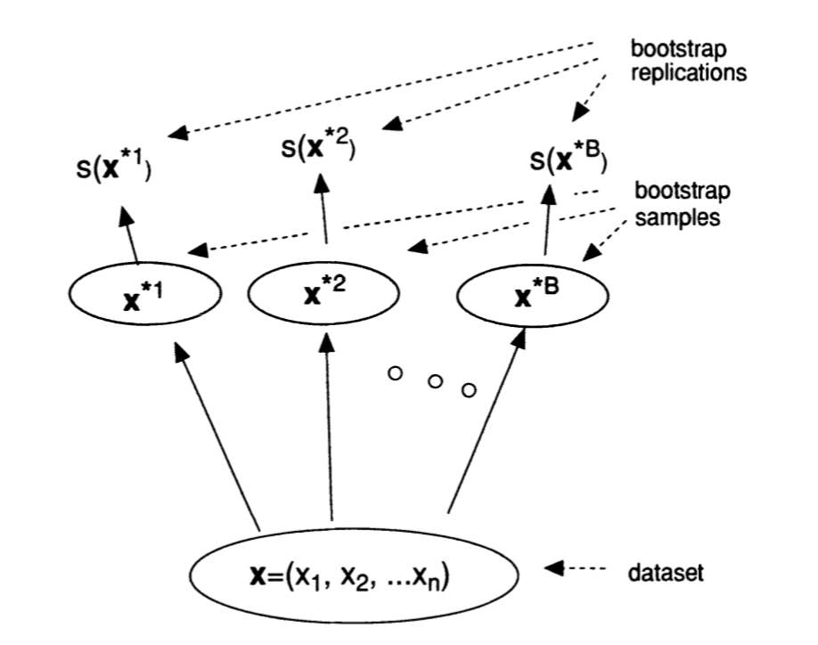
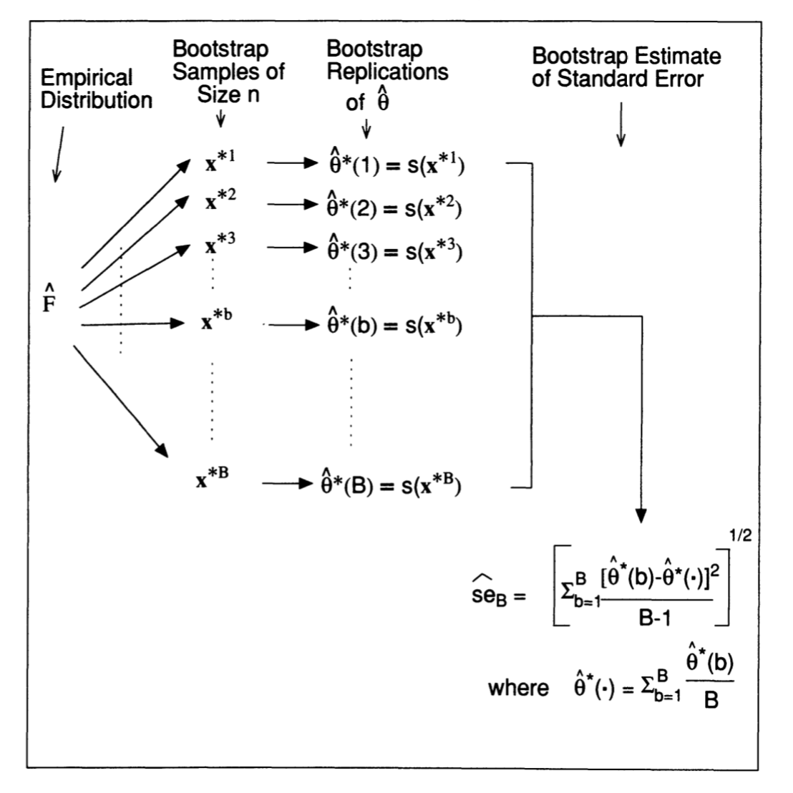
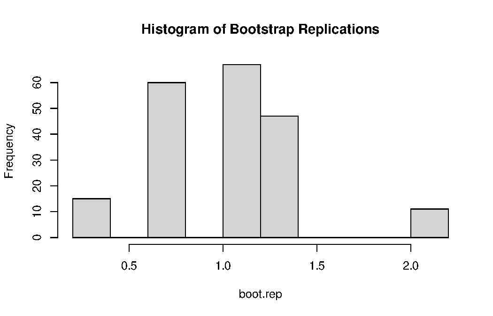
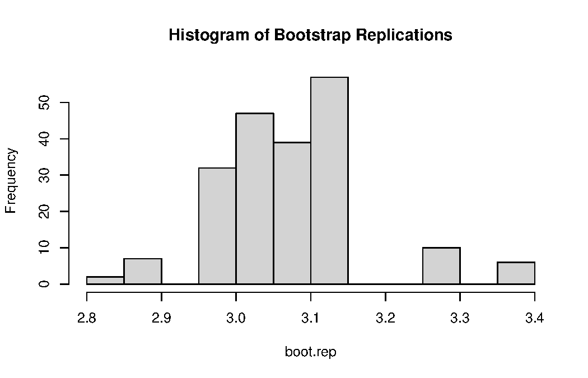
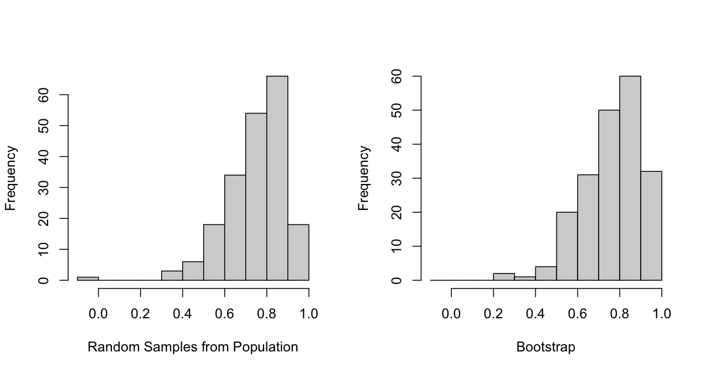
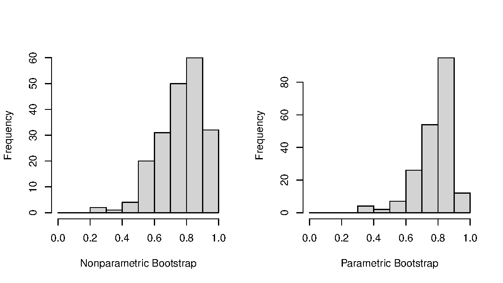
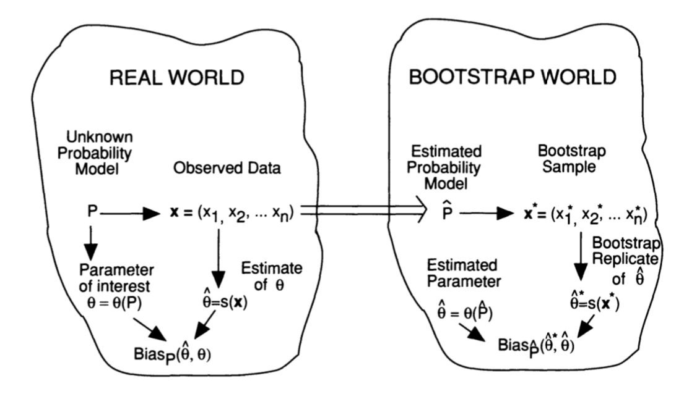
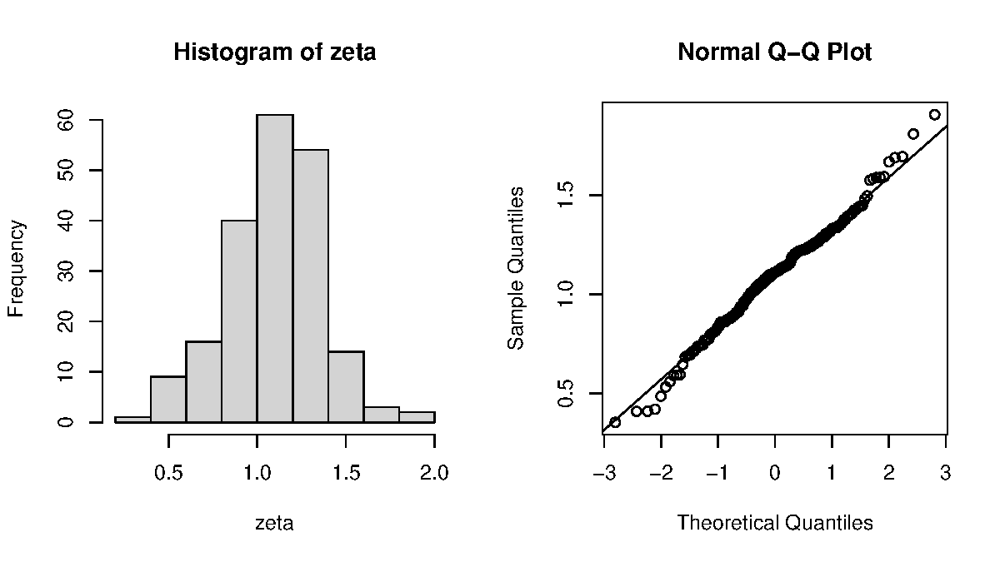
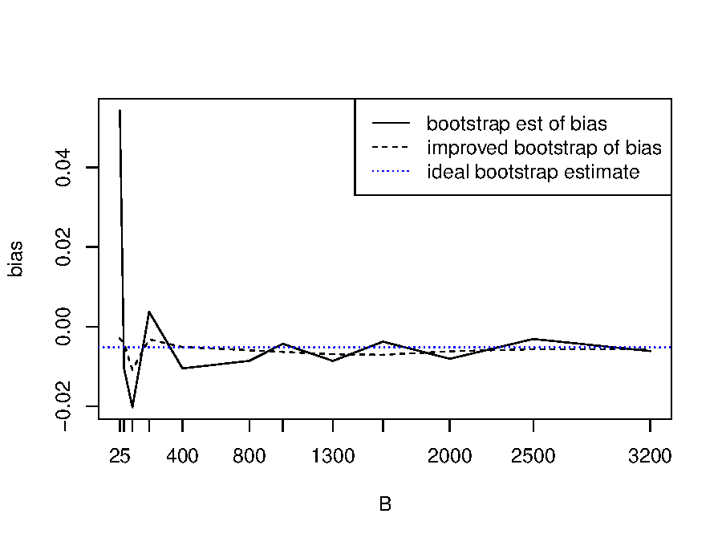



::: {.content-visible when-format="html"}
::: {.page-buttons}
[ PDF](s4p1.pdf){.btn .btn-sm .btn-outline-dark}


<div class="page-codefiles">All code on this page, in one file: </div>
:::

Every code block on this page runs in your browser. Click *Run Code*, change the code,
run it again. The R session loads `boot` and `MASS`, so the first block you run takes a
few extra seconds. **Run the data block in Section 1.3 first.** Everything after it
uses `law` and `law82`.
:::

## Bootstrap estimation of standard error

### Motivation

-   Suppose $X= (X_1, \ldots, X_n)$ is a random sample from an unknown underlying distribution $F$.
-   [**Goal**]{.term}: estimate [a parameter of interest]{.term} $\theta = t(F)$ based on $X$.
-   For this purpose, we calculate [an estimate]{.term} $\hat{\theta} = s(X)$ from $X$.
-   In a concrete example,
    -   The parameter of interest is the population mean $\theta = \mu_F$.
    -   We get the estimate $\hat{\theta}$ by $s(X) = \bar{X}$.
-   The question is "[How accurate is $\hat{\theta}$]{.term}?"

### Estimating the standard error of the mean

-   The population mean is $\theta = \mu_F$ and the variance of $F$ is $\sigma^2_F$.
-   We have shown before that, regardless of $F$, $\bar{X} \sim (\mu_F, \sigma_F^2/n)$.
-   The [**standard error**]{.term} of the sample mean $\bar{X}$ is written as $\mathrm{se}_F(\bar{x}) = \sigma_F/\sqrt{n}$.
-   The standard error is the most common way of indicating [**statistical accuracy**]{.term}.
-   If $n$ is large enough, following the CLT, we expect $\bar{X}$ to be
    -   Less than one standard error away from $\mu_F$ about $68\%$ of the time.

$$
P\left( |\bar{X} - \mu_F| < \sigma_F / \sqrt{n} \right) \approx 68.3 \%.
$$

-   Less than two standard errors away from $\mu_F$ about $95\%$ of the time.

$$
P\left( |\bar{X} - \mu_F| < 2\sigma_F / \sqrt{n} \right) \approx 95.4 \%.
$$

### Datasets `law82` and `law`

-   [**Population**]{.term} (accessible in this example): `law82`, $n = 82$.
-   [**Sample**]{.term}: `law`, $n = 15$.

We have access to the whole population in this dataset, which makes it a good teaching example. In practice, the population is almost never available.

**Run this block first.** Everything after it uses `law` and `law82`.

::: {.panel-tabset}

#### R

```{webr}
law <- read.csv("data/law.csv")
law82 <- read.csv("data/law82.csv")
head(law82)
```

```{webr}
sampled.school <- merge(law82, law, by = c("LSAT", "GPA"))$School
head(within(law82, sampled <- School %in% sampled.school))
```

#### Python

```{pyodide}
import pandas as pd
import numpy as np

law = pd.read_csv("data/law.csv")
law82 = pd.read_csv("data/law82.csv")
import scipy.stats
law_GPA = law["GPA"].to_numpy()
law82_GPA = law82["GPA"].to_numpy()
print(law82.head())
```

```{pyodide}
sampled_school = law82.merge(law, on=["LSAT", "GPA"])["School"]
print(law82.assign(sampled=law82["School"].isin(sampled_school)).head())
```

:::

The two data frames also ship with the R package `bootstrap` as `law` and `law82`; the copies here are plain CSV files so both languages can read them.

### Confidence interval for the population mean

::: {.panel-tabset}

#### R

```{webr}
(n <- length(law$GPA))
mean(law$GPA)
```

```{webr}
(se <- sd(law$GPA) / sqrt(n))
mean(law$GPA) + 2 * c(-1, 1) * se
```

```{webr}
# check the true population mean
mean(law82$GPA)
```

#### Python

```{pyodide}
n = len(law_GPA)
print(np.mean(law_GPA))
se = np.std(law_GPA, ddof=1) / np.sqrt(n)
print(se)
print(np.mean(law_GPA) + np.array([-1, 1]) * 2 * se)
print(np.mean(law82_GPA))
```

:::

The interval is $(2.969, 3.220)$ and the truth is $3.135$. It worked here. The next two subsections explain why this approach does not always work.

### Two problems

-   **Issue 1**: The accuracy obtained based on the CLT is correct for large sample sizes, but can sometimes be quite [inaccurate]{.term} for the sample size actually available.
-   **Issue 2**: For virtually any estimate $\hat{\theta}$ other than the mean, there is [no neat formula]{.term} like $\sigma_F/\sqrt{n}$ that enables us to directly gauge the statistical accuracy.
-   **Approach**: compute the asymptotic standard error through large-sample theory.
-   For example, the [**median**]{.term}, which can be used as a robust estimator of the population mean.
-   Suppose $X_1, \ldots, X_n \stackrel{iid}{\sim}(\mu_F, \sigma^2_F)$ with symmetric pdf $f_X$, and $f_X$ is continuous and positive at $\mu_F$. Let $\tilde{X}_n$ be the [sample median]{.term}. By the asymptotic theory of sample quantiles (a CLT applied to the empirical CDF),

$$
\sqrt{n}\left(\tilde{X}_{n}-\mu_F\right) \stackrel{d}{\longrightarrow} \mathrm{N}\left(0, \frac{1}{4f_X^2(\mu_F)}\right).
$$

If $X_i$ are normally distributed, $f_X(\mu_F) = 1/(\sqrt{2\pi}\,\sigma_F)$, so $\frac{1}{4f_X^2(\mu_F)} = \frac{\pi}{2}\sigma_F^2$.

-   That is to say, the [standard error of the sample median]{.term} is $\sqrt{\frac{\pi}{2}} \frac{\sigma_F}{\sqrt{n}} \approx 1.253 \frac{\sigma_F}{\sqrt{n}}$ under normality.

That derivation needed asymptotic theory for sample quantiles, a symmetry assumption, and a normality assumption. The bootstrap needs none of these calculations.

### Confidence interval for the population median

::: {.panel-tabset}

#### R

```{webr}
median(law$GPA)
(se <- sd(law$GPA) / sqrt(n) * sqrt(pi/2))
```

```{webr}
median(law$GPA) + 2 * c(-1, 1) * se
# check the true population median
median(law82$GPA)
```

#### Python

```{pyodide}
print(np.median(law_GPA))
se = np.std(law_GPA, ddof=1) / np.sqrt(n) * np.sqrt(np.pi/2)
print(se)
print(np.median(law_GPA) + np.array([-1, 1]) * 2 * se)
print(np.median(law82_GPA))
```

:::

### Bootstrap

-   In 1979, Efron introduced the [**bootstrap**]{.term} as a computer-based method for [estimating the standard error of the estimator $\hat{\theta} = s(X)$]{.term}.

Efron, B. (1979) *Bootstrap methods: another look at the jackknife*. **Annals of Statistics**. **7**, 1--26.

-   The bootstrap enjoys the advantage of being [completely automatic]{.term}. The bootstrap estimate of standard error
    -   Requires no theoretical calculations.
    -   Is thus available no matter how mathematically complicated the estimator may be.
-   The [**bootstrap data points**]{.term} $X_1^\star, \ldots, X_n^\star$ are a random sample of size $n$ [with replacement]{.term} from the population of $n$ objects $(X_1, \ldots, X_n)$.
-   Corresponding to a bootstrap data set ${X}^\star$ is a [**bootstrap replication**]{.term} of $\hat{\theta}$, namely $\hat{\theta^\star} = s(X^\star)$. The quantity $s(X^\star)$ is the result of applying the same function $s(\cdot)$ to $X^\star$ as was applied to $X$.
-   The standard error, $\mathrm{se}_F(\hat{\theta})$, can be estimated from these bootstrap replications.

{width="62%" fig-align="center"}

[Source: Efron and Tibshirani (1994) *An Introduction to the Bootstrap*. CRC Press.]{.source}

### One bootstrap sample

[ Predict]{.mode}: the blocks below draw one bootstrap sample of size 5 from `x`. Before you run them: will every value of `x` appear exactly once?

::: {.panel-tabset}

#### R

```{webr}
set.seed(5400)
x <- c(0.3, 0.7, 1.2, 1.4, 2.1)              # original sample
median(x)                                    # s(X)
(boot.samp <- sample(x, replace = TRUE))     # one bootstrap sample X*
median(boot.samp)                            # s(X*)
```

#### Python

```{pyodide}
np.random.seed(5400)
x = [0.3, 0.7, 1.2, 1.4, 2.1]                # original sample
print(np.median(x))                          # s(X)
boot_samp = np.random.choice(x, len(x))      # one bootstrap sample X*
print(boot_samp)
print(np.median(boot_samp))                  # s(X*)
```

:::

-   `np.random.choice(x, len(x), replace=True)`: sampling with replacement (default).
-   `np.random.choice(x, len(x), replace=False)`: sampling without replacement.

::: {.callout-note collapse="true" title="Answer"}
**No.** In R the bootstrap sample is `0.7 0.3 0.7 2.1 1.2`: one value appears twice and one does not appear at all. This is expected. Sampling with replacement is what makes $X^\star$ a draw from $\hat{F}$.

The chance that a particular observation is left out of a bootstrap sample is $(1 - 1/n)^n$, which tends to $e^{-1} \approx 0.368$. So each bootstrap sample uses only about 63 percent of your distinct data points.

::: {.panel-tabset}

#### R

```r
mean(replicate(10000, !(1 %in% sample(5, 5, replace = TRUE))))
(1 - 1/5)^5
```

#### Python

```python
np.mean([1 not in np.random.choice(np.arange(1, 6), 5) for b in range(10000)])
(1 - 1/5)**5
```

:::

That 0.632 shows up again in the 0.632 bootstrap estimator of prediction error, and it is the basis of the jackknife-after-bootstrap method later on this page.
:::

### Bootstrap for estimating standard error $\mathrm{se}_F(\hat{\theta})$

1.  Generate $B$ independent [bootstrap samples]{.term} $X^{\star 1}, \ldots, X^{\star B}$, each of which has $n$ observations drawn with replacement from the original sample $X$.
2.  Compute the [bootstrap replications]{.term} ($B=50$, say):

$$
\hat{\theta}^{*}(b)=s\left(\mathbf{x}^{* b}\right), \quad b=1,2, \cdots, B.
$$

3.  Estimate the standard error $\mathrm{se}_F(\hat{\theta})$ by the sample standard deviation of $\hat{\theta}^{*}(1), \ldots, \hat{\theta}^{*}(B)$:

$$
\widehat{\mathrm{se}}_{B}=\sqrt{\frac{1}{B-1}\sum_{b=1}^{B}\left[\hat{\theta}^{*}(b)-\hat{\theta}^{*}(\cdot)\right]^{2}},
\qquad
\hat{\theta}^{*}(\cdot)=\frac{1}{B}\sum_{b=1}^{B} \hat{\theta}^{*}(b).
$$

{width="52%" fig-align="center"}

[Source: Efron and Tibshirani (1994) *An Introduction to the Bootstrap*. CRC Press.]{.source}

### Number of bootstrap replications

The limit of $\widehat{\mathrm{se}}_B$ as [$B \to \infty$]{.term} is the [**ideal bootstrap estimate**]{.term} of $\mathrm{se}_F(\hat{\theta})$.

Two rules of thumb, cited from Efron and Tibshirani (1994):

-   Even a small number of bootstrap replications, say $B = 25$, is usually informative; [$B = 50$ is often enough]{.term} to give a good estimate of $\mathrm{se}_F(\hat{\theta})$.
-   Very seldom are more than [$B = 200$]{.term} replications needed for [estimating a standard error]{.term}. Much [**bigger**]{.term} values of $B$ are required for [**bootstrap confidence intervals**]{.term}; this is discussed later.

### A toy example

::: {.panel-tabset}

#### R

```{webr}
set.seed(5400)
# original sample
x <- c(0.3, 0.7, 1.2, 1.4, 2.1)
median(x)

# Generate B bootstrap samples and replications
boot.rep <- rep(NA, 200)
for (b in seq(200)) {
  boot.sample <- sample(x, replace = TRUE)
  boot.rep[b] <- median(boot.sample)
}
sd(boot.rep)
```

#### Python

```{pyodide}
np.random.seed(5400)
x = [0.3, 0.7, 1.2, 1.4, 2.1]
print(np.median(x))

# Generate B bootstrap samples and replicates
boot_rep = []
n = len(x)
for i in range(200):
    boot_sample = np.random.choice(x, n)
    boot_rep.append(np.median(boot_sample))

print(np.std(boot_rep, ddof=1))
```

:::

The loop can be replaced by `replicate(B, expr)`, which evaluates `expr` B times. Here B = 200.

::: {.panel-tabset}

#### R

```{webr}
set.seed(5400)
# one bootstrap sample per column
boot.samp <- replicate(200, sample(x, replace = TRUE))
boot.rep <- apply(boot.samp, 2, median)
sd(boot.rep)
hist(boot.rep, main = "Histogram of Bootstrap Replications")
```

#### Python

```{pyodide}
import matplotlib.pyplot as plt

np.random.seed(5400)
# one bootstrap sample per column, as in replicate()
boot_samp = np.random.choice(x, size=(len(x), 200))
boot_rep = np.median(boot_samp, axis=0)
print(np.std(boot_rep, ddof=1))
plt.hist(boot_rep, edgecolor='k')
plt.title("Histogram of Bootstrap Replications")
plt.show()
```

:::

{width="62%" fig-align="center"}

That histogram has only a handful of distinct bars. With $n = 5$ the median of a bootstrap sample can only be one of the five original values, so the bootstrap distribution of a median is discrete no matter how large $B$ is. Keep this picture in mind for the jackknife failure later.

### Example: `law82` and `law`

Recall that the [asymptotic standard error of the median]{.term} is 0.0788. How about the bootstrap estimate?

::: {.panel-tabset}

#### R

```{webr}
set.seed(5400)
B <- 200
boot.samp <- replicate(B, sample(law$GPA, replace = TRUE))
boot.rep <- apply(boot.samp, 2, median)
sd(boot.rep)
```

```{webr}
hist(boot.rep, main = "Histogram of Bootstrap Replications")
```

#### Python

```{pyodide}
np.random.seed(5400)
B = 200
boot_samp = np.random.choice(law_GPA, size=(len(law_GPA), B))
boot_rep = np.median(boot_samp, axis=0)
print(np.std(boot_rep, ddof=1))
```

```{pyodide}
import matplotlib.pyplot as plt

plt.hist(boot_rep, edgecolor='k')
plt.title("Histogram of Bootstrap Replications")
plt.show()
```

:::

{width="62%" fig-align="center"}

### R package `boot`

::: {.panel-tabset}

#### R

```{webr}
library(boot)
set.seed(5400)
m <- function(x, i) median(x[i])
boot.rep2 <- boot(data = law$GPA, statistic = m, R = 200)
sd(boot.rep2$t)
```

#### Python

```{pyodide}
# what boot() does, by hand: draw an index vector i, then call the statistic
np.random.seed(5400)
def m(x, i):
    return np.median(x[i])

n = len(law_GPA)
boot_rep2 = np.array([m(law_GPA, np.random.randint(0, n, n)) for b in range(200)])
print(np.std(boot_rep2, ddof=1))
```

:::

The documentation of the package `boot` is the [boot reference manual](https://cran.r-project.org/web/packages/boot/boot.pdf).

The statistic passed to `boot` must take **two** arguments: the data and an index vector. `boot` generates the indices and hands them to you; writing `median(x)` instead of `median(x[i])` would resample nothing and return the same number 200 times.

### `bootstrap` function in `scipy.stats`

```{pyodide}
from scipy.stats import bootstrap

np.random.seed(5400)
data = (law_GPA.ravel(), )
print(bootstrap(data, np.median, n_resamples=200).standard_error)
```

Reference: [scipy.stats.bootstrap](https://docs.scipy.org/doc/scipy/reference/generated/scipy.stats.bootstrap.html).

### True standard error of the sample median

Because the population is available here, we can estimate the sampling standard error by simulation. Each simulated sample draws 15 schools from the 82 with replacement, so the 15 values are iid draws from the population. This is the same iid model that the bootstrap assumes. $B = 200$ such samples give an estimate, not the exact value.

::: {.panel-tabset}

#### R

```{webr}
set.seed(5400)
B <- 200
real.samp <- replicate(B, sample(law82$GPA, 15, replace = TRUE))
samp.dist.median <- apply(real.samp, 2, median)
sd(samp.dist.median)
```

#### Python

```{pyodide}
np.random.seed(5400)
B = 200
real_samp = np.column_stack([np.random.choice(law82_GPA, 15, replace=True)
                             for b in range(B)])
samp_dist_median = np.median(real_samp, axis=0)
print(np.std(samp_dist_median, ddof=1))
```

:::

In this example, the asymptotic standard error of the median, 0.0788, is closer to the simulated standard error, 0.0637, than the bootstrap estimate, 0.0973, is.

The bootstrap is not always the best estimate. On a sample of 15, a formula that assumes normality can do better. The advantage of the bootstrap is that it can estimate a standard error without an analytic formula, provided the resampling scheme suits how the data were collected.

## Empirical distribution

### The empirical distribution function

-   The [**bootstrap estimate**]{.term} of $\mathrm{se}_F(\hat{\theta})$ is the standard deviation of the bootstrap replications of $\hat{\theta}$. It is written $\mathrm{se}_{\hat{F}}(\hat{\theta}^\star)$.
-   Having observed a random sample of size $n$ from a probability distribution $F$,

$$
F \xrightarrow{\mathrm{iid}} (X_1, \ldots, X_n),
$$

the [**empirical distribution function**]{.term} $\hat{F}$ is defined to be the discrete distribution that puts probability $1/n$ on each value $X_i$, $i = 1, \ldots, n$.

-   A bootstrap sample can be seen as a random sample of size $n$ drawn from $\hat{F}$:

$$
\hat{F} \xrightarrow{\mathrm{iid}} X^\star = (X_1^\star, \ldots, X_n^\star).
$$

-   The bootstrap estimate is the standard error of $\hat{\theta}$ for [data sets of size $n$ randomly sampled from $\hat{F}$]{.term}.

### Real world versus bootstrap world

-   [**Real world**]{.term}: underlying distribution $\to$ observed data,

$$
F \xrightarrow{\mathrm{iid}} X = (X_1, \ldots, X_n), \qquad \text{estimate } \hat{\theta} = s(X).
$$

-   [**Bootstrap world**]{.term}: empirical distribution $\to$ bootstrap sample,

$$
\hat{F} \xrightarrow{\mathrm{iid}} X^\star = (X_1^\star, \ldots, X_n^\star), \qquad \text{replicate } \hat{\theta}^\star = s(X^\star).
$$

In the bootstrap world, we can resample as many times as we like, which we cannot do in the real world. The bootstrap estimate is good when $\hat{F}$ is close to $F$.

### Example 1 of empirical distribution

-   Consider a random sample of 100 rolls of a die. The outcomes $1, 2, 3, 4, 5, 6$ occurred $13, 19, 10, 17, 14, 27$ times, respectively.
-   The empirical distribution $\hat{F}$ puts probability $1/100$ on each of the 100 outcomes.
-   In cases like this, where there are repeated values, we can express $\hat{F}$ more economically as the vector of [observed frequencies]{.term} $\hat{f}_k$, $k = 1, \ldots, 6$, with $\hat{f}_k = \#\{X_i = k\}/n$. In this example, $\hat{F} = \{.13, .19, .10, .17, .14, .27\}$.

### Example 2 of empirical distribution

The empirical distribution $\hat{F}$ assigns to a set $A$ in the sample space of $X$ its empirical probability

$$
\widehat{\mathrm{Prob}}\{A\} = \#\{X_i \in A\}/n.
$$

Consider the GPA in the law school sample of size $n = 15$:

::: {.panel-tabset}

#### R

```{webr}
law$GPA
```

#### Python

```{pyodide}
print(law_GPA)
```

:::

The empirical distribution $\hat{F}$ puts probability $1/15$ on each of the 15 data points. The empirical probability for the set $\{0 < X < 3\}$ is $1/3$:

::: {.panel-tabset}

#### R

```{webr}
mean(law$GPA < 3)
```

#### Python

```{pyodide}
print(np.mean(law_GPA < 3))
```

:::

### The plug-in principle

-   We may write parameters as functions of $F$, $\theta = t(F)$.
-   For example, if $F$ is a probability distribution on the real line, then the expectation can be thought of as the parameter

$$
\theta = t(F) = \mathrm{E}_{F}(X) = \int x \, dF(x).
$$

-   The [**plug-in principle**]{.term} is a simple method of estimating parameters from samples: $\hat{\theta} = t(\hat{F})$.
-   In other words, we estimate the function $\theta = t(F)$ of the probability distribution $F$ by the same function of the empirical distribution $\hat{F}$:

$$
\hat{\theta} = t(\hat{F}) = \mathrm{E}_{\hat{F}}(X) = \frac{1}{n}\sum_{i=1}^n X_i = \bar{X}.
$$

### Plug-in estimate: variance

-   The plug-in estimate of $\sigma^2_{F} = \mathrm{E}_{F}(X - \mu_F)^2$ is

$$
\begin{aligned}
\hat{\sigma}^2 &= \sigma_{\hat{F}}^2
= \mathrm{E}_{\hat{F}}\left[(X - \mu_{\hat{F}})^2\right]
= \frac{1}{n}\sum_{i=1}^n(X_i - \bar{X})^2,
\end{aligned}
$$

where $\mu_{\hat{F}} = \bar{X}$.

-   The [**plug-in estimate**]{.term} is slightly different from the usual estimated variance

$$
\bar{\sigma}^2 = \frac{1}{n-1}\sum_{i=1}^n(X_i - \bar{X})^2.
$$

-   Dividing by $n-1$ rather than $n$ makes $\bar{\sigma}^2$ unbiased for $\sigma_F^2$. For most purposes $\hat{\sigma}^2$ is just as good as $\bar{\sigma}^2$.

This is the same $n$ versus $n-1$ split we met in Section 3.1, where R's `var` and NumPy's `np.var` disagreed. Now it has a name: `np.var` is the plug-in estimate.

### Plug-in estimate: sample correlation coefficient

The question is how correlated LSAT and GPA are.

$$
\mathrm{corr}(Y, Z) = \frac{\mathrm{E}(Y - \mathrm{E}Y)(Z - \mathrm{E}Z)}{[\mathrm{E}(Y - \mathrm{E}Y)^2\,\mathrm{E}(Z - \mathrm{E}Z)^2]^{1/2}}
$$

-   [Population]{.term} correlation coefficient:

$$
\operatorname{corr}(y, z)
=\frac{\frac{1}{82}\sum_{j=1}^{82}\left(Y_{j}-\mu_{y}\right)\left(Z_{j}-\mu_{z}\right)}{\left[\frac{1}{82}\sum_{j=1}^{82}\left(Y_{j}-\mu_{y}\right)^{2} \frac{1}{82}\sum_{j=1}^{82}\left(Z_{j}-\mu_{z}\right)^{2}\right]^{1 / 2}},
$$

with $\mathrm{E}_{F}Y = \mu_y = \sum_{j=1}^{82}Y_j/82$ and $\mathrm{E}_{F}Z = \mu_z = \sum_{j=1}^{82}Z_j/82$.

-   [Sample]{.term} correlation coefficient, by the plug-in principle:

$$
\widehat{\operatorname{corr}}(y, z)
=\frac{\frac{1}{15}\sum_{j=1}^{15}\left(Y_{j}-\hat{\mu}_{y}\right)\left(Z_{j}-\hat{\mu}_{z}\right)}{\left[\frac{1}{15}\sum_{j=1}^{15}\left(Y_{j}-\hat{\mu}_{y}\right)^{2} \frac{1}{15}\sum_{j=1}^{15}\left(Z_{j}-\hat{\mu}_{z}\right)^{2}\right]^{1 / 2}}.
$$

-   The [**bootstrap estimate**]{.term} is also a [plug-in estimate]{.term} that uses the empirical distribution $\hat{F}$ in place of the unknown distribution $F$. The bootstrap algorithm uses $\mathrm{se}_{\hat{F}}(\hat{\theta})$ to estimate $\mathrm{se}_F(\hat{\theta})$:

$$
\widehat{\mathrm{se}}_B(\hat{\theta}) \xrightarrow{\mathrm{approximate}}\widehat{\mathrm{se}}_{\infty}(\hat{\theta}) = \mathrm{se}_{\hat{F}}(\hat{\theta}) \xrightarrow{\mathrm{estimate}}\mathrm{se}_F(\hat{\theta})
$$

The two arrows are two different errors. A larger $B$ reduces the first one (Monte Carlo error). It does not fix the second one, a poor approximation of $F$ by $\hat{F}$.

### Example: correlation coefficient

::: {.panel-tabset}

#### R

```{webr}
cor(law$LSAT, law$GPA) # the sample correlation
```

```{webr}
# use bootstrap to estimate the standard error
set.seed(5400)
B <- 200; n <- nrow(law)
boot.rep <- rep(NA, B)
for (b in seq(B)) {
  id <- sample(n, n, replace = TRUE)
  boot.rep[b] <- cor(law$LSAT[id], law$GPA[id])
}
sd(boot.rep)
```

#### Python

```{pyodide}
print(law["LSAT"].corr(law["GPA"]))
```

```{pyodide}
np.random.seed(5400)
B = 200
n = law.shape[0]
boot_rep = []

for i in range(B):
    sample = law.sample(n=n, replace=True, axis=0)
    boot_rep.append(sample["LSAT"].corr(sample["GPA"]))

print(np.std(boot_rep, ddof=1))
```

:::

A slightly different result is obtained by the `boot` package, because it draws its indices in a different order:

::: {.panel-tabset}

#### R

```{webr}
set.seed(5400)
r <- function(x, i) cor(x[i, 1], x[i, 2])
boot.rep2 <- boot(data = law, statistic = r, R = 200)
sd(boot.rep2$t)
```

#### Python

```{pyodide}
import scipy.stats
from scipy.stats import bootstrap

law_GPA = np.array(law[["GPA"]]).ravel()
law_LSAT = np.array(law[["LSAT"]]).ravel()

def my_corr(dat1, dat2):
    return scipy.stats.pearsonr(dat1, dat2)[0]

np.random.seed(5400)
print(bootstrap(data=(law_GPA, law_LSAT), statistic=my_corr,
  vectorized=False, paired=True, n_resamples=200).standard_error)
```

:::

### Population sampling versus bootstrap sampling

Random samples drawn from the true underlying distribution (left panel) and from the empirical distribution (right panel). Each population sample draws 15 schools from the 82 with replacement, so the 15 schools are iid draws from the population, the same iid model the bootstrap assumes.

::: {.panel-tabset}

#### R

```{webr}
set.seed(5400)
n <- nrow(law)
sample.cor <- rep(NA, 200)
for (b in seq(200)) {
  id <- sample(82, n, replace = TRUE)
  sample.cor[b] <- cor(law82$LSAT[id], law82$GPA[id])
}
```

```{webr}
set.seed(5400)
par(mfrow = c(1, 2))
hist(sample.cor,
  xlab = "Random Samples from Population",
  main = "", breaks = seq(-0.1, 1, 0.1))
hist(boot(data = law, statistic = r, R = 200)$t,
  breaks = seq(-0.1, 1, 0.1),
  xlab = "Bootstrap", main = "")
```

#### Python

```{pyodide}
import matplotlib.pyplot as plt

np.random.seed(5400)
B = 200
n = law.shape[0]
sample_cor = []
boot_cor = []
for i in range(B):
    sample = law82.sample(n=n, replace=True, axis=0)
    sample_cor.append(sample["LSAT"].corr(sample["GPA"]))
    bt = law.sample(n=n, replace=True, axis=0)
    boot_cor.append(bt["LSAT"].corr(bt["GPA"]))
```

```{pyodide}
plt.subplot(1, 2, 1)
plt.hist(sample_cor, edgecolor='k')
plt.xlabel("Random Samples from Population")
plt.subplot(1, 2, 2)
plt.hist(boot_cor, edgecolor='k')
plt.xlabel("Bootstrap")
plt.show()
```

:::

{width="78%" fig-align="center"}

The two histograms have similar spread but different centers. The left one is centered near the population correlation, 0.76. The right one is centered near this sample's correlation, 0.78. The bootstrap estimates the *spread* well, but its *center* comes from the sample.

## Parametric bootstrap

### Nonparametric and parametric bootstrap

The ideal bootstrap estimate $\mathrm{se}_{\hat{F}}(\hat{\theta}^\star)$ and its approximation $\hat{\mathrm{se}}_B$ are sometimes called [**nonparametric bootstrap estimates**]{.term} because they are based on $\hat{F}$, the empirical distribution. The empirical distribution is a purely nonparametric estimate of the population $F$, without relying on model assumptions.

[**Parametric bootstrap**]{.term} uses a different estimate of $F$. The bootstrap sampling can be carried out parametrically.

-   For the law data, $X=(Y, Z) = (\mathrm{LSAT}, \mathrm{GPA})$, a [**nonparametric estimate**]{.term} of $F$ is $\hat{F}_{\mathrm{empirical}}$.
-   We may further [assume]{.term} that the population has a [bivariate normal distribution]{.term}.
-   Reasonable estimates of the mean and covariance of this population are given by $(\bar{y}, \bar{z})$ and

$$
\frac{1}{14}\left(\begin{array}{cc}{\sum_{i=1}^{15}\left(y_{i}-\overline{y}\right)^{2}} & {\sum_{i=1}^{15}\left(y_{i}-\overline{y}\right)\left(z_{i}-\overline{z}\right)} \\ {\sum_{i=1}^{15}\left(y_{i}-\overline{y}\right)\left(z_{i}-\overline{z}\right)} & {\sum_{i=1}^{15}\left(z_{i}-\overline{z}\right)^{2}}\end{array}\right).
$$

-   Denote the bivariate normal population with this mean and covariance by $\hat{F}_\mathrm{norm}$. This is a [**parametric estimate**]{.term} of $F$.
-   The parametric bootstrap estimate of the standard error of the correlation $\hat{\theta}$ is $\mathrm{se}_{\hat{F}_\mathrm{norm}}(\hat{\theta}^\star)$.

::: {.panel-tabset}

#### R

```{webr}
library(MASS)
set.seed(5400)
# mean and cov for generating bivariate normal var
mu <- colMeans(law)
covmat <- cov(law)
```

```{webr}
# parametric bootstrap replications of the correlation
boot.par.cor <- rep(NA, 200)
for (b in seq(200)) {
  boot.par.cor[b] <- cor(mvrnorm(n = 15, mu, covmat))[2]
}
sd(boot.par.cor)
```

#### Python

```{pyodide}
np.random.seed(5400)
# column means and covariance, as plain arrays
mu = law[['LSAT', 'GPA']].mean().values
covmat = law[['LSAT', 'GPA']].cov().values
boot_par_cor = []

for i in range(200):
    sample = np.random.multivariate_normal(mu, covmat, 15)
    sample = pd.DataFrame(sample, columns=['LSAT', 'GPA'])
    boot_par_cor.append(sample["LSAT"].corr(sample["GPA"]))

print(np.std(boot_par_cor, ddof=1))
```

:::

::: {.panel-tabset}

#### R

```{webr}
set.seed(5400)
par(mfrow = c(1, 2))
hist(boot(data = law, statistic = r, R = 200)$t,
  breaks = seq(0, 1, 0.1),
  xlab = "Nonparametric Bootstrap", main = "")
hist(boot.par.cor, breaks = seq(0, 1, 0.1),
  xlab = "Parametric Bootstrap", main = "")
```

#### Python

```{pyodide}
import matplotlib.pyplot as plt

np.random.seed(5400)
law_LSAT = law["LSAT"].to_numpy()
n = len(law_GPA)
idmat = np.random.randint(0, n, size=(200, n))
boot_np_cor = [np.corrcoef(law_LSAT[idx], law_GPA[idx])[0, 1] for idx in idmat]
breaks = np.linspace(0, 1, 11)
plt.subplot(1, 2, 1)
plt.hist(boot_np_cor, bins=breaks, edgecolor='k')
plt.xlabel("Nonparametric Bootstrap")
plt.subplot(1, 2, 2)
plt.hist(boot_par_cor, bins=breaks, edgecolor='k')
plt.xlabel("Parametric Bootstrap")
plt.show()
```

:::

{width="72%" fig-align="center"}

The parametric version is smoother, because it can produce values the data never showed. This helps when the bivariate normal model is right, and it can mislead when the model is wrong.

### Standard error of the sample correlation coefficient

-   The standard error estimated by the parametric bootstrap is closely related to textbook standard error formulae.
-   The textbook says the [standard error of the correlation coefficient]{.term} is $\dfrac{1 - \hat{\theta}^2}{\sqrt{n-3}}$.
-   Substituting $\hat{\theta}$ with the sample estimate gives a value of 0.115 for the law school data, close to the standard error given by the parametric bootstrap.

::: {.panel-tabset}

#### R

```{webr}
(rhat <- cor(law$LSAT, law$GPA))
(1 - rhat^2) / sqrt(nrow(law) - 3)
```

#### Python

```{pyodide}
rhat = np.corrcoef(law_LSAT, law_GPA)[0, 1]
print(rhat)
print((1 - rhat**2) / np.sqrt(law.shape[0] - 3))
```

:::

## Bootstrap estimation of bias

### Bias

-   So far we have concentrated on standard error as a measure of accuracy for an estimator $\hat{\theta}$.
-   Now we consider another useful measure of statistical accuracy, [**bias**]{.term}.
-   To estimate the population parameter $\theta = t(F)$, suppose we use a plug-in estimator $\hat{\theta} = t(\hat{F})$.
-   The bias of $\hat{\theta}$ as an estimate of $\theta$ is defined to be the difference between the expectation of $\hat{\theta}$ and the value of the parameter $\theta$:

$$
\mathrm{bias}_F = \mathrm{E}_F(\hat{\theta}) - t(F) = \mathrm{E}_F(\hat{\theta}) - \theta.
$$

-   An estimator is [**unbiased**]{.term} if $\mathrm{E}_F(\hat{\theta}) = \theta$.

### Bootstrap estimation of bias

-   The bootstrap estimate of bias is defined to be the estimate $\mathrm{bias}_{\hat{F}}$ we obtain by substituting $\hat{F}$ for $F$:

$$
\mathrm{bias}_{\hat{F}} = \mathrm{E}_{\hat{F}}(\hat{\theta}^\star) - t(\hat{F}) = \mathrm{E}_{\hat{F}}(\hat{\theta}^\star) - \hat{\theta}.
$$

-   The ideal bootstrap estimate $\mathrm{bias}_{\hat{F}}$ can be approximated:
    1.  Generate independent bootstrap samples $X^{\star 1}, \ldots, X^{\star B}$.
    2.  Evaluate the bootstrap replications $\hat{\theta}^{\star b} = s(X^{\star b})$.
    3.  Approximate the [**bootstrap expectation**]{.term} $\hat{\theta}^{\star}(\cdot)=\sum_{b=1}^{B} \hat{\theta}^{\star b}/ B$.
-   The bootstrap estimate of bias based on the $B$ replications:

$$
\widehat{\mathrm{bias}}_B = \hat{\theta}^{\star}(\cdot) - t(\hat{F}),
\qquad
\widehat{\mathrm{bias}}_{\infty} = \mathrm{bias}_{\hat{F}} = \mathrm{E}_{\hat{F}}(\hat{\theta}^\star) - \hat{\theta}.
$$

{width="65%" fig-align="center"}

[Source: Efron and Tibshirani (1994) *An Introduction to the Bootstrap*. CRC Press.]{.source}

::: {.panel-tabset}

#### R

```{webr}
set.seed(5400)
# sample estimate of correlation
(rhat <- cor(law$LSAT, law$GPA))
```

```{webr}
# bootstrap estimate of bias
B <- 200; n <- nrow(law)
boot.r <- rep(NA, B)
for (b in seq(B)) {
  id <- sample(n, n, replace = TRUE)
  boot.r[b] <- cor(law$LSAT[id], law$GPA[id])
}
(bias <- mean(boot.r - rhat))
```

```{webr}
bias / sd(boot.r)
2 * sd(boot.r) / sqrt(200)
```

#### Python

```{pyodide}
np.random.seed(5400)
rhat = law["LSAT"].corr(law["GPA"])
print(rhat)

B = 200
n = law.shape[0]
boot_r = []
for i in range(B):
    bt = law.sample(n=n, replace=True, axis=0)
    boot_r.append(bt["LSAT"].corr(bt["GPA"]))

bias = np.mean(boot_r - rhat)
print(bias)
```

```{pyodide}
print(bias / np.std(boot_r, ddof=1))
print(2 * np.std(boot_r, ddof=1) / np.sqrt(200))
```

:::

### Is that bias worth worrying about?

-   The ratio of estimated bias to standard error is small:

$$
\left|\frac{\widehat{\mathrm{bias}}_{200}}{\widehat{\mathrm{se}}_{200}}\right| = \left|\frac{\texttt{mean(boot.r - rhat)}}{\texttt{sd(boot.r)}}\right| = 0.051.
$$

-   As a rule of thumb, [a bias of less than $.25$ standard errors can be ignored]{.term}, unless we are trying to do careful confidence interval calculations.
-   It can be shown that the root mean squared error equals

$$
\begin{aligned}
\sqrt{\mathrm{E}_{F}\left[(\hat{\theta}-\theta)^{2}\right]}
&=\sqrt{\mathrm{se}_{F}(\hat{\theta})^{2}+\mathrm{bias}_{F}(\hat{\theta}, \theta)^{2}} \\
&=\mathrm{se}_{F}(\hat{\theta}) \cdot \sqrt{1+\left(\frac{\mathrm{bias}_F}{\mathrm{se}_F}\right)^{2}} \\
&\approx \mathrm{se}_{F}(\hat{\theta}) \cdot\left[1+\frac{1}{2}\left(\frac{\mathrm{bias}_F}{\mathrm{se}_{F}}\right)^{2}\right].
\end{aligned}
$$

If $|\mathrm{bias}_F/\mathrm{se}_F| \le .25$, then the root mean squared error is no more than about $3.1\%$ greater than $\mathrm{se}_F$.

### How many bootstrap replications is enough?

-   Usually $B=200$ is more than enough to obtain a good estimate of standard error. Is it good enough to estimate bias?
-   The answer is no in this particular case:

$$
\begin{aligned}
&\mathrm{Prob}_{\hat{F}}\left\{\left|\hat{\theta}^{*}(\cdot)-\mathrm{E}_{\hat{F}}(\hat{\theta}^{*}) \right|<2 \frac{\widehat{\mathrm{se}}_B}{\sqrt{B}}\right\} \\
=\ &\mathrm{Prob}_{\hat{F}}\left\{\left|\widehat{\mathrm{bias}}_{B}-\widehat{\mathrm{bias}}_{\infty}\right|<2 \frac{\widehat{\mathrm{se}}_{B}}{\sqrt{B}}\right\} \approx .95,
\end{aligned}
$$

where in this example $\hat{\mathrm{se}}_B = 0.127$ and $B = 200$, thus

$$
\mathrm{Prob}_{\hat{F}}\left\{\left|\widehat{\mathrm{bias}}_{B}-\widehat{\mathrm{bias}}_{\infty}\right|<0.0180 \right\} \approx .95.
$$

-   The error bound is large compared to the estimated bias $\widehat{\mathrm{bias}}_{200} = -0.0066$.
-   We probably have $|\widehat{\mathrm{bias}}_{\infty}| < 0.0066 + 0.0180 = 0.0246$ and so $|\widehat{\mathrm{bias}}|/\widehat{\mathrm{se}} < 0.193$, still less than [the rule of thumb $0.25$]{.term}.

Standard errors and biases need different numbers of replicates. A bias is a small difference between two large quantities. Monte Carlo noise that is small compared with a standard error can be large compared with a bias.

### Application: the bias of the best of 20 prompts

-   In [Section 3.3](../section3/s3p3.html#application-trying-many-prompts-and-keeping-the-best) we tried 20 prompts and kept the one with the highest accuracy. The best prompt scores too high, because we picked the one with the largest sample accuracy. We want to know the size of this bias.
-   The statistic is $\hat{\theta} = \max_k \hat{p}_k$, the accuracy of the best prompt. There is no simple formula for its bias, so we estimate the bias by the bootstrap.
-   We simulate the data, as in Section 3.3. We set the true accuracy of every prompt to $0.70$: each prompt answers each question correctly with probability $0.70$. There are 20 prompts, each scored on the same 200 questions. One bootstrap sample draws 200 questions with replacement, scores all 20 prompts on them, and takes the best.

[ Predict]{.mode}: the true accuracy of every prompt is $0.70$, because we set it so. In Section 3.3 we saw that the best of 20 prompts scores about $0.76$ on average, because we pick the luckiest one. So the true bias of $\hat{\theta}$ is about $0.76 - 0.70 = 0.06$. Will the bootstrap estimate of bias be close to $0.06$?

::: {.panel-tabset}

#### R

```{webr}
set.seed(5400)
K <- 20; n <- 200
Y <- matrix(rbinom(K * n, 1, 0.70), K, n)      # row k: prompt k on the 200 questions
(theta.hat <- max(rowMeans(Y)))                # accuracy of the best prompt
best <- function(d, i) max(colMeans(d[i, ]))   # d has one row per question
boot.obj <- boot(data = t(Y), statistic = best, R = 2000)
(bias <- mean(boot.obj$t) - theta.hat)         # bootstrap estimate of bias
bias / sd(boot.obj$t)
```

#### Python

```{pyodide}
np.random.seed(5400)
K = 20; n = 200
Y = np.random.binomial(1, 0.70, size=(K, n))      # row k: prompt k on the 200 questions
theta_hat = Y.mean(axis=1).max()                  # accuracy of the best prompt
print(theta_hat)
idmat = np.random.randint(0, n, size=(2000, n))   # 2000 resamples of the questions
boot_t = np.array([Y[:, i].mean(axis=1).max() for i in idmat])
bias = boot_t.mean() - theta_hat                  # bootstrap estimate of bias
print(bias, bias / np.std(boot_t, ddof=1))
```

:::

::: {.callout-note collapse="true" title="Answer"}
**No. In R the bootstrap estimate is $0.017$, about one third of the true $0.06$.** The sign is right, but the size is too small.

-   The estimate is about $0.85$ standard errors, so by the rule of thumb this bias cannot be ignored. The rule of thumb gives the right conclusion.
-   The bootstrap world is built on $\hat{F}$. In $\hat{F}$ the winning prompt has accuracy $0.785$, higher than the other 19. In most bootstrap samples it is still the best, so the bootstrap repeats only a small part of the selection. Under the true $F$ all 20 prompts have the same accuracy, and the full $0.06$ is caused by selection.
-   Because the selection is already built into $\hat{F}$, the bootstrap underestimates the bias. The fix from Section 3.3 still works: choose the prompt on one set of questions and score it on another set.
:::

## Jackknife

### Jackknife estimate of bias

-   The [**jackknife**]{.term} was the original computer-based method for estimating biases and standard errors. It was proposed by Maurice Quenouille in the mid 1950s.
-   Given a data set $X = (X_1, \ldots, X_n)$, the $i$th [**jackknife sample**]{.term} $X_{(i)}$ is defined to be $X$ with the $i$th data point removed (leave-one-out):

$$
X_{(i)} = (X_1, X_2, \ldots, X_{i-1}, X_{i+1}, \ldots, X_n).
$$

-   The $i$th [**jackknife replication**]{.term} $\hat{\theta}_{(i)}$ of the statistic $\hat{\theta} = s(X)$ is $\hat{\theta}_{(i)} = s(X_{(i)})$.
-   The [**jackknife estimate of bias**]{.term} is defined by

$$
\widehat{\mathrm{bias}}_{\mathrm{jack}} = (n-1)\left(\overline{\hat{\theta}_{(\cdot)}} - \hat{\theta}\right),
\qquad
\overline{\hat{\theta}_{(\cdot)}} = \frac{1}{n}\sum_{i=1}^n \hat{\theta}_{(i)}.
$$

::: {.callout-note collapse="true" title="Why $(n-1)$ in the jackknife?"}
**For this variance estimator, the expected leave-one-out change is the bias divided by $n-1$.**

Consider the case when $\theta$ is the population variance. The [plug-in estimate of the variance]{.term} of $X$ is $\hat{\theta} = \frac{1}{n}\sum_{i=1}^n (X_i - \bar{X})^2$. The estimator $\hat{\theta}$ is biased for $\sigma^2_F$ with

$$
\mathrm{bias}(\hat{\theta}) = \mathrm{E}_F(\hat{\theta} - \sigma^2_F) = \frac{n-1}{n}\sigma_F^2 - \sigma_F^2 = -\frac{\sigma_F^2}{n}.
$$

Each jackknife replicate computes the estimate $\hat{\theta}_{(i)}$ on a sample of size $n-1$, so its bias is $-\sigma_F^2/(n-1)$. Thus for $i=1,\ldots, n$,

$$
\begin{aligned}
\mathrm{E}_F[\hat{\theta}_{(i)} - \hat{\theta}] &= \mathrm{bias}(\hat{\theta}_{(i)}) - \mathrm{bias}(\hat{\theta})\\
&= -\frac{\sigma_F^2}{n-1} + \frac{\sigma_F^2}{n} = -\frac{\sigma_F^2}{n(n-1)} = \frac{\mathrm{bias}(\hat{\theta})}{n-1}.
\end{aligned}
$$

Multiplying this expected change by $n-1$ therefore gives the bias. For other estimators the relation is only approximate.
:::

::: {.panel-tabset}

#### R

```{webr}
set.seed(5400)
(rhat <- cor(law$LSAT, law$GPA))
n <- nrow(law)
# jackknife estimate of bias
jack.r <- rep(NA, n)
for (i in seq(n)) {
  jack.r[i] <- cor(law$LSAT[-i], law$GPA[-i])
}
(jack.bias <- (n - 1) * (mean(jack.r) - rhat))
```

```{webr}
# bootstrap estimate of bias
set.seed(5400)
r <- function(x, i) cor(x[i, 1], x[i, 2])
boot.rep2 <- boot(data = law, statistic = r, R = 2000)
(boot.bias <- mean(boot.rep2$t) - rhat)
```

#### Python

```{pyodide}
np.random.seed(5400)
rhat = law["LSAT"].corr(law["GPA"])
n = law.shape[0]
jack_r = []

for i in range(n):
    dt = law.drop(index=[i])
    jack_r.append(dt["LSAT"].corr(dt["GPA"]))

jack_bias = (n - 1) * (np.mean(jack_r) - rhat)
print(jack_bias)
```

```{pyodide}
# bootstrap estimate of bias; boot() by hand
np.random.seed(5400)
law_LSAT = law["LSAT"].to_numpy()
def r(i):
    return np.corrcoef(law_LSAT[i], law_GPA[i])[0, 1]

boot_rep2 = np.array([r(np.random.randint(0, n, n)) for b in range(2000)])
boot_bias = np.mean(boot_rep2) - rhat
print(boot_bias)
```

:::

The jackknife needs only $n = 15$ recomputations. The bootstrap used 2000. The two bias estimates differ by less than 0.0006.

The same leave-one-out loop is used in cross-validation. There we fit a prediction model on the $n - 1$ remaining points and test it on the removed point. The average error over the $n$ points estimates the prediction error.

### Jackknife estimate of standard error

A jackknife estimate of standard error, due to John Tukey in the late 1950s, is

$$
\widehat{\mathrm{se}}_{\mathrm{jack}} = \sqrt{\frac{n-1}{n} \sum_{i=1}^n \left(\hat{\theta}_{(i)} - \overline{\hat{\theta}_{(\cdot)}}\right)^2},
$$

for smooth statistics $\hat{\theta}$.

::: {.panel-tabset}

#### R

```{webr}
# jackknife estimate of se
(jack.se <- sqrt((n - 1) / n * sum((jack.r - mean(jack.r))^2)))
```

```{webr}
# bootstrap estimate of se
(boot.se <- sd(boot.rep2$t))
```

#### Python

```{pyodide}
jack_se = ((n - 1) / n * np.sum((jack_r - np.mean(jack_r))**2))**0.5
print(jack_se)
```

```{pyodide}
# bootstrap estimate of se
boot_se = np.std(boot_rep2, ddof=1)
print(boot_se)
```

:::

### Failure of the jackknife

[**Jackknife:**]{.term}

-   Pros: a [simple]{.term} and [good]{.term} approximation to the bootstrap.
-   Cons: relies on a [smoothness]{.term} assumption for the sample statistic.

-   The jackknife is a *linear* approximation to the bootstrap: it estimates how $\hat{\theta}$ responds to small changes of $\hat{F}$. That needs $\hat{\theta}$ to be smooth in the data. The mean and the correlation are smooth. The median and other quantiles are not.
-   For the median of `law$LSAT`, the jackknife standard error is about 14.7 and the bootstrap gives about 18.8. With 15 points, deleting one observation gives at most three possible medians, so the jackknife replicates vary too little, and the estimated standard error is too small. The code is in the optional part at the end of this page.
-   For a median, use the delete-$d$ jackknife with $d > 1$, or use the bootstrap.

## Bootstrap confidence intervals

We now consider how to [construct confidence intervals]{.term} for the target parameter using the bootstrap. We introduce the following five intervals:

-   The standard [**norm**]{.term}al bootstrap confidence interval.
-   The [**basic**]{.term} bootstrap confidence interval.
-   The bootstrap [**perc**]{.term}entile confidence interval.
-   The bootstrap [**stud**]{.term}entized $t$ confidence interval.
-   The [**BC$_a$**]{.term} bootstrap confidence interval.

### Method 1: standard normal bootstrap CI

Notation on this page: $z_{\alpha}$, $b_{\alpha}$, and $\hat{\theta}^\star_{\alpha}$ (subscript) denote upper-$\alpha$ points. For example, $z_{0.025} = 1.96$.

Suppose that $\hat{\theta}$ is an estimator of parameter $\theta$ and the standard error of the estimator is $\mathrm{se}(\hat{\theta})$. Assume the standardized estimator

$$
Z = \frac{\hat{\theta} - \mathrm{E}(\hat{\theta})}{\mathrm{se}(\hat{\theta})}
$$

is approximately standard normal. A large $n$ alone does not give this: the sample maximum is a counterexample. If $\hat{\theta}$ is unbiased for $\theta$, then an approximate $100(1-\alpha)\%$ CI for $\theta$ is

$$
\left(\hat{\theta} - z_{\alpha/2}\, \mathrm{se}(\hat{\theta}), \ \hat{\theta} + z_{\alpha/2}\, \mathrm{se}(\hat{\theta})\right).
$$

::: {.panel-tabset}

#### R

```{webr}
set.seed(5400)
# sample mean
muhat <- mean(law$GPA)
m <- function(x, i) mean(x[i])
# bootstrap estimate of se
boot.obj <- boot(data = law$GPA, statistic = m, R = 2000)
(boot.se <- sd(boot.obj$t))
```

```{webr}
muhat + c(-1, 1) * qnorm(0.975) * boot.se
```

```{webr}
# from boot package
boot.ci(boot.obj, type = "norm")
```

#### Python

```{pyodide}
from scipy.stats import bootstrap

np.random.seed(5400)
muhat = np.mean(law_GPA)
boot_se = bootstrap(data=(law_GPA,), statistic=np.mean,
  n_resamples=2000).standard_error
print(boot_se)
print(muhat + np.array([-1, 1]) * scipy.stats.norm.ppf(0.975) * boot_se)
```

```{pyodide}
# boot.ci(type = "norm") by hand: it also subtracts the bootstrap bias
def norm_ci(t0, t):
    bias = np.mean(t) - t0
    return t0 - bias + np.array([-1, 1]) * scipy.stats.norm.ppf(0.975) * np.std(t, ddof=1)

np.random.seed(5400)
n = len(law_GPA)
boot_t = np.mean(law_GPA[np.random.randint(0, n, size=(2000, n))], axis=1)
print(norm_ci(muhat, boot_t))
```

:::

### Transformation-respecting property

Suppose $(\hat{\theta}_\mathrm{low}, \hat{\theta}_\mathrm{up})$ is a confidence interval of $\theta$. Let $\phi = m(\theta)$ for a strictly increasing function $m$. The interval is [**transformation-respecting**]{.term} if the interval for $\phi$ is $(m(\hat{\theta}_\mathrm{low}), m(\hat{\theta}_\mathrm{up}))$, with the same confidence level. For a decreasing transformation, reverse the transformed endpoints.

[The standard normal CI is not transformation-respecting.]{.term} Take $\phi = \exp(\theta)$. We can transform the two endpoints of the interval for $\theta$, or we can bootstrap $\exp(\hat{\theta})$ directly. For the standard normal method, the two intervals differ. At the end of this section, we run this test on four of the five methods.

### Method 2: basic bootstrap CI

-   Let $b_{\alpha/2}$ and $b_{1-\alpha/2}$ be the quantiles of $\hat{\theta}-\theta$, such that

$$
\begin{aligned}
&P(b_{1 - \alpha/2} < \hat{\theta} - \theta < b_{\alpha/2}) = 1 - \alpha \\
\Rightarrow\ &P\left(\hat{\theta} - b_{\alpha/2} < \theta < \hat{\theta} - b_{1 - \alpha/2}\right) = 1 - \alpha.
\end{aligned}
$$

-   Estimate $b_{\alpha/2}$ and $b_{1 - \alpha/2}$ based on the empirical distribution:

$$
\hat{b}_{\alpha/2} = \hat{\theta}^\star_{\alpha/2} - \hat{\theta},\qquad
\hat{b}_{1-\alpha/2} = \hat{\theta}^\star_{1-\alpha/2} - \hat{\theta}.
$$

-   Thus an approximate $100(1-\alpha)\%$ confidence interval is $\left(\hat{\theta} - \hat{b}_{\alpha/2},\ \hat{\theta} - \hat{b}_{1 - \alpha/2}\right)$, which is equivalent to

$$
\left(2\hat{\theta} - \hat{\theta}^\star_{\alpha/2},\ 2\hat{\theta} - \hat{\theta}^\star_{1 - \alpha/2}\right).
$$

[The basic CI is not transformation-respecting.]{.term}

::: {.panel-tabset}

#### R

```{webr}
# basic bootstrap CI
set.seed(5400)
boot.obj <- boot(data = law$GPA, statistic = m, R = 2000)
boot.quan <- quantile(boot.obj$t, c(0.975, 0.025), type = 6)
2 * muhat - boot.quan
```

```{webr}
# from boot package
boot.ci(boot.obj, type = "basic")
```

#### Python

```{pyodide}
# basic bootstrap CI
np.random.seed(5400)
n = len(law_GPA)
boot_t = np.mean(law_GPA[np.random.randint(0, n, size=(2000, n))], axis=1)
# method="weibull" is the same rule as R's quantile type = 6
boot_quan = np.quantile(boot_t, [0.975, 0.025], method="weibull")
print(2 * muhat - boot_quan)
```

```{pyodide}
np.random.seed(5400)
print(bootstrap(data=(law_GPA,), statistic=np.mean,
  n_resamples=2000, method='basic').confidence_interval)
```

:::

Note the reversed quantile order, `c(0.975, 0.025)`. The basic interval reflects the bootstrap distribution through $\hat\theta$, so the upper bootstrap quantile becomes the lower endpoint.

### Method 3: bootstrap percentile confidence interval

-   [**Bootstrap percentile confidence intervals**]{.term} use the empirical distribution as the reference distribution.
-   A $100(1-\alpha)\%$ confidence interval is obtained by estimating the quantiles $\theta_{\alpha/2}$ and $\theta_{1-\alpha/2}$ from the bootstrap replicates $\hat{\theta}^{\star 1}, \ldots, \hat{\theta}^{\star B}$:

$$
\left(\hat{\theta}^{\star(\alpha/2)},\ \hat{\theta}^{\star(1-\alpha/2)}\right).
$$

[The percentile CI is transformation-respecting.]{.term}

::: {.panel-tabset}

#### R

```{webr}
# bootstrap percentile CI
set.seed(5400)
boot.obj <- boot(data = law$GPA, statistic = m, R = 2000)
(boot.quan <- quantile(boot.obj$t, c(0.025, 0.975), type = 6))
```

```{webr}
# from boot package
boot.ci(boot.obj, type = "perc")
```

#### Python

```{pyodide}
# bootstrap percentile CI
np.random.seed(5400)
n = len(law_GPA)
boot_t = np.mean(law_GPA[np.random.randint(0, n, size=(2000, n))], axis=1)
boot_quan = np.quantile(boot_t, [0.025, 0.975], method="weibull")
print(boot_quan)
```

```{pyodide}
np.random.seed(5400)
print(bootstrap(data=(law_GPA,), statistic=np.mean,
  n_resamples=2000, method='percentile').confidence_interval)
```

:::

It is transformation-respecting for a simple reason: quantiles pass through strictly increasing functions. The 2.5th percentile of the distribution of $\exp(\hat\theta^\star)$ *is* $\exp$ of the 2.5th percentile of $\hat\theta^\star$. With a finite $B$, a sample quantile that interpolates between two replicates can make the two sides differ slightly.

### Method 4: bootstrap $t$ CI

-   Recall the $t$ distribution is used when the standard error is unknown. In this case $\widehat{\mathrm{se}}(\hat{\theta})$ is unknown and it is estimated by the bootstrap.
-   [**The bootstrap $t$ intervals**]{.term} do not use a $t$-distribution as the reference. They generate a "$t$-type" statistic by resampling.
-   One disadvantage is that the estimates of standard error $\mathrm{se}(\hat{\theta}^{\star b})$ must typically be obtained by a second bootstrap, which makes the [computation expensive]{.term}.
-   [The bootstrap $t$ interval is not transformation-respecting.]{.term}

The algorithm:

-   Compute the observed sample statistic $\hat{\theta} = s(X)$.
-   For each $b = 1, \ldots, B$:
    1.  Get a bootstrap sample $X^{\star b}$ by sampling from $X$ with replacement.
    2.  Compute the bootstrap replication $\hat{\theta}^{\star b} = s(X^{\star b})$.
    3.  Estimate the standard error $\hat{\mathrm{se}}(\hat{\theta}^{\star b})$ by another bootstrap.
    4.  Compute the replicate of the $t$-statistic $t^{\star b}=\frac{\hat{\theta}^{\star b}-\hat{\theta}}{\hat{\mathrm{se}}(\hat{\theta}^{\star b})}$.
-   From the replicates $t^{\star 1}, \ldots, t^{\star B}$, find quantiles $t^\star_{\alpha/2}$ and $t^\star_{1 - \alpha/2}$.
-   Compute $\hat{\mathrm{se}}(\hat{\theta})$, the sample standard deviation of $\hat{\theta}^{\star 1}, \ldots, \hat{\theta}^{\star B}$.
-   Confidence interval:

$$
\left(\hat{\theta} - t^\star_{\alpha/2}\, \hat{\mathrm{se}}(\hat{\theta}), \ \hat{\theta} - t^\star_{1-\alpha/2}\, \hat{\mathrm{se}}(\hat{\theta})\right).
$$

With the upper-tail notation, $t^\star_{\alpha/2}$ is large and positive and $t^\star_{1-\alpha/2}$ is usually negative. For example, if they are $2$ and $-2$, the interval is $\hat{\theta} \pm 2\,\hat{\mathrm{se}}(\hat{\theta})$.

::: {.panel-tabset}

#### R

```{webr}
# use bootstrap to estimate se
set.seed(5400)
mean.se <- function(x, i) {
  m <- function(x, i) mean(x[i])
  mu <- mean(x[i])
  v <- var(boot(data = x[i], statistic = m, R = 500)$t)
  c(mu, v)
}
boot.obj2 <- boot(data = law$GPA, statistic = mean.se, R = 500)
boot.ci(boot.obj2, type = "stud")
```

#### Python

```{pyodide}
# bootstrap t CI by hand: an inner bootstrap inside each outer one
np.random.seed(5400)
def mean_se(x, i):
    xi = x[i]
    idmat = np.random.randint(0, len(xi), size=(500, len(xi)))
    mu = np.mean(xi)
    v = np.var(np.mean(xi[idmat], axis=1), ddof=1)
    return mu, v

n = len(law_GPA)
t0, v0 = mean_se(law_GPA, np.arange(n))  # like boot.obj2$t0
t_star = np.empty(500)
for b in range(500):
    mu_b, v_b = mean_se(law_GPA, np.random.randint(0, n, n))
    t_star[b] = (mu_b - t0) / np.sqrt(v_b)
# boot.ci uses se = sqrt(v0); its quantile rule differs a little from np.quantile
print(t0 - np.quantile(t_star, [0.975, 0.025]) * np.sqrt(v0))
```

:::

This block runs 500 outer times 500 inner resamples, so it stays quick in the browser. Try at home: `R = 2000` in both loops, which is sixteen times the work.

::: {.callout-warning title="Variance, not standard error"}
**Return the variance, not the standard deviation.**

`boot.ci(type = "stud")` expects the **second** element returned by your statistic to be the **variance** of the replicate, not its standard deviation. Passing `sd(...)` runs without any warning and produces a wrong interval.

The R help page for `boot.ci` documents this under the `var.t` and `index` arguments. This is one kind of bug: an argument whose *scale* is wrong rather than whose *type* is wrong. R stops with an error when the type is wrong. It gives no message when only the scale is wrong.
:::

The replicates $t^{\star b}$ are also a check on the usual $t$ interval (Hesterberg, 2015). If the data are skewed, the 2.5% and 97.5% quantiles of $t^{\star b}$ are not $\pm t_{\alpha/2, n-1}$. One tail is too long and the other is too short. For exponential data, $n$ must be several thousand before the one-sided coverage of the $t$ interval is close to its nominal level (Hesterberg, 2015). [Section 3.2](../section3/s3p2.html#how-large-is-large-enough) checked only two-sided coverage. Two-sided coverage can look fine even when each tail is wrong, because the error in one tail partly cancels the error in the other.

### Method 5: BC$_a$

-   BC$_a$ stands for bias-corrected and accelerated.
-   The BC$_a$ interval is given by percentiles of the bootstrap distribution, but the two percentiles are adjusted by two numbers:
    -   the [**bias-correction**]{.term} $\hat{z}_0 = \Phi^{-1}\left(\#\{\hat{\theta}^{\star b} < \hat{\theta}\}/B\right)$, which measures how far the median of $\hat{\theta}^\star$ is from $\hat{\theta}$, expressed as a standard normal quantile;
    -   the [**acceleration**]{.term} $\hat{a}$, which allows the standard error of $\hat{\theta}$ to change with $\theta$. It is computed from the skewness of the jackknife replicates.
-   When $\hat{z}_0 = 0$ and $\hat{a} = 0$, the BC$_a$ interval is the percentile interval.
-   In large samples, BC$_a$ intervals are [**more accurate**]{.term} than the standard normal and percentile intervals: their coverage error goes to zero faster. The formulas are in Chapter 14 of Efron and Tibshirani (1994).

[The BC$_a$ interval is transformation-respecting.]{.term}

Note that $\hat a$ is computed from the jackknife. So BC$_a$ uses both the bootstrap and the jackknife, and it may share the jackknife's problems with non-smooth statistics.

::: {.panel-tabset}

#### R

```{webr}
# BCa
set.seed(5400)
boot.obj <- boot(data = law$GPA, statistic = m, R = 2000)
boot.ci(boot.obj, type = "bca")
```

#### Python

```{pyodide}
np.random.seed(5400)
print(bootstrap(data=(law_GPA,), statistic=np.mean,
  n_resamples=2000, method='bca').confidence_interval)
```

:::

### Comparing four intervals on a transformation

[ Predict]{.mode}: there are two ways to get an interval for $\exp(\theta)$: transform the endpoints of the interval for $\theta$, or bootstrap $\exp(\bar{x})$ directly. For which of the four methods do the two ways give the same interval?

::: {.panel-tabset}

#### R

```{webr}
# CIs for theta and exp(theta)
m <- function(x, i) mean(x[i])
mexp <- function(x, i) exp(mean(x[i]))
set.seed(5400)
boot.obj <- boot(data = law$GPA, statistic = m, R = 2000)
set.seed(5400)
boot.exp <- boot(data = law$GPA, statistic = mexp, R = 2000)
allb <- unlist(boot.ci(boot.obj, type = c("norm", "basic", "perc", "bca")))
allb.exp <- unlist(boot.ci(boot.exp, type = c("norm", "basic", "perc", "bca")))
```

```{webr}
rbind(
  normal   = c(exp(c(allb$normal2, allb$normal3)),
               c(allb.exp$normal2, allb.exp$normal3)),
  basic    = c(exp(c(allb$basic4, allb$basic5)),
               c(allb.exp$basic4, allb.exp$basic5)),
  percent  = c(exp(c(allb$percent4, allb$percent5)),
               c(allb.exp$percent4, allb.exp$percent5)),
  bca      = c(exp(c(allb$bca4, allb$bca5)),
               c(allb.exp$bca4, allb.exp$bca5)))
```

#### Python

```{pyodide}
# CIs for theta and exp(theta); norm_ci() is defined in Method 1
from scipy.stats import bootstrap

def mexp(x, axis=-1):
    return np.exp(np.mean(x, axis=axis))

n = len(law_GPA)
np.random.seed(5400)
boot_t = np.mean(law_GPA[np.random.randint(0, n, size=(2000, n))], axis=1)
allb = {"normal": norm_ci(np.mean(law_GPA), boot_t)}
allb_exp = {"normal": norm_ci(np.exp(np.mean(law_GPA)), np.exp(boot_t))}
for method in ["basic", "percentile", "bca"]:
    np.random.seed(5400)
    allb[method] = bootstrap((law_GPA,), np.mean, n_resamples=2000,
                             method=method).confidence_interval
    np.random.seed(5400)
    allb_exp[method] = bootstrap((law_GPA,), mexp, n_resamples=2000,
                                 method=method).confidence_interval
```

```{pyodide}
for method in allb:
    print(f"{method:>10}", np.round(np.exp(allb[method]), 4),
          np.round(np.array(allb_exp[method]), 4))
```

:::

Columns one and two transform the interval for $\theta$; columns three and four bootstrap $\exp(\theta)$ directly. Percentile matches exactly. BC$_a$ matches to two decimals. Normal and basic do not.

### Bootstrap confidence interval for the correlation

::: {.panel-tabset}

#### R

```{webr}
set.seed(5400)
# population correlation
cor(law82$LSAT, law82$GPA)
```

```{webr}
# estimate cor and the variance of the bootstrap replicates
set.seed(5400)
mean.se <- function(x, i) {
  corfun <- function(x, i) cor(x$LSAT[i], x$GPA[i])
  v <- var(boot(data = x[i, ], statistic = corfun, R = 500)$t)
  c(corfun(x, i), v)
}
boot.obj <- boot(data = law, statistic = mean.se, R = 500)   # try at home: R = 2000 in both loops
boot.ci(boot.obj, type = "all")
```

#### Python

```{pyodide}
# population correlation
print(np.corrcoef(law82["LSAT"], law82["GPA"])[0, 1])
```

```{pyodide}
np.random.seed(5400)
print(bootstrap(data=(law_GPA, law_LSAT), statistic=my_corr,
  vectorized=False, paired=True, method='bca',
  n_resamples=2000).confidence_interval)
```

```{pyodide}
# basic and percentile intervals, for comparison with boot.ci
# a vectorized correlation: one value per resample, so it runs fast
def corr_vec(y, z, axis=-1):
    yc = y - y.mean(axis=axis, keepdims=True)
    zc = z - z.mean(axis=axis, keepdims=True)
    return (yc * zc).sum(axis) / np.sqrt((yc**2).sum(axis) * (zc**2).sum(axis))

for method in ["basic", "percentile"]:
    np.random.seed(5400)
    print(method, bootstrap(data=(law_GPA, law_LSAT), statistic=corr_vec,
      paired=True, method=method, n_resamples=2000).confidence_interval)
```

:::

The five intervals disagree substantially here, far more than they did for the mean. The bootstrap distribution of a correlation on $n = 15$ is skewed and bounded. The normal and basic intervals tend to do poorly in this case, and BC$_a$ was designed to adjust for bias and skewness.

### Application: a confidence interval for a model's accuracy

-   A model answers $n = 300$ questions. In [Section 3.2](../section3/s3p2.html#application-a-models-accuracy-is-a-sample-mean), we treated its accuracy as a sample mean and used the Wald or Wilson interval. The bootstrap gives an interval without a formula, and the same code works for any other score.
-   We reuse the simulation of [Section 3.3](../section3/s3p3.html#application-is-model-a-better-than-model-b): question $i$ has difficulty $d_i$, model A answers it correctly with probability $\mathrm{logit}^{-1}(1 + 2d_i)$, and model B with probability $\mathrm{logit}^{-1}(1.3 + 2d_i)$.

::: {.panel-tabset}

#### R

```{webr}
set.seed(5400)
n <- 300
d <- rnorm(n)                                    # difficulty of each question
A <- rbinom(n, 1, plogis(1.0 + 2 * d))           # 1 if model A is correct
B <- rbinom(n, 1, plogis(1.3 + 2 * d))           # 1 if model B is correct
mean(A)
acc <- function(x, i) mean(x[i])
boot.A <- boot(A, acc, R = 2000)
boot.ci(boot.A, type = c("perc", "bca"))
prop.test(sum(A), n, correct = FALSE)$conf.int   # Wilson interval, Section 3.2
```

#### Python

```{pyodide}
np.random.seed(5400)
n = 300
d = np.random.normal(size=n)                     # difficulty of each question
A = np.random.binomial(1, 1 / (1 + np.exp(-(1.0 + 2 * d))))   # 1 if model A is correct
B = np.random.binomial(1, 1 / (1 + np.exp(-(1.3 + 2 * d))))   # 1 if model B is correct
print(A.mean())
for method in ["percentile", "bca"]:
    np.random.seed(5400)
    print(method, bootstrap((A,), np.mean, n_resamples=2000, method=method).confidence_interval)
print(scipy.stats.binomtest(int(A.sum()), n).proportion_ci(method="wilson"))   # Wilson interval
```

:::

In R, the percentile interval is $(0.630, 0.733)$, BC$_a$ is $(0.627, 0.730)$, and Wilson is $(0.625, 0.730)$. For the mean of 0/1 data the three agree, as they should. Here the Wilson formula is enough. In the next two examples there is no simple formula, and the bootstrap is needed.

**Two models on the same questions.** Hard questions are hard for both models, so $A_i$ and $B_i$ are correlated. We resample the questions, and each question keeps its pair $(A_i, B_i)$.

[ Predict]{.mode}: if we resample $A$ and $B$ separately, the pairs are broken. Is the interval from separate resampling wider or narrower than the paired one?

::: {.panel-tabset}

#### R

```{webr}
set.seed(5400)
dat <- data.frame(A, B)
dif <- function(x, i) mean(x$B[i] - x$A[i])     # question i keeps its pair (A_i, B_i)
boot.D <- boot(dat, dif, R = 2000)
mean(B - A)
sd(boot.D$t)                                    # paired bootstrap SE
boot.ci(boot.D, type = "perc")
```

```{webr}
# wrong: resample A and B separately, which breaks the pairs
set.seed(5400)
wrong <- replicate(2000, mean(sample(B, replace = TRUE)) - mean(sample(A, replace = TRUE)))
sd(wrong)
```

#### Python

```{pyodide}
np.random.seed(5400)
idmat = np.random.randint(0, n, size=(2000, n))            # resampled questions
boot_D = np.array([np.mean(B[i] - A[i]) for i in idmat])   # question i keeps its pair
print(np.mean(B - A))
print(np.std(boot_D, ddof=1))                              # paired bootstrap SE
print(np.quantile(boot_D, [0.025, 0.975], method="weibull"))
```

```{pyodide}
# wrong: resample A and B separately, which breaks the pairs
wrong = [np.mean(np.random.choice(B, n)) - np.mean(np.random.choice(A, n)) for b in range(2000)]
print(np.std(wrong, ddof=1))
```

:::

::: {.callout-note collapse="true" title="Answer"}
**Wider.** In R the paired SE is $0.031$ and the separate one is $0.038$.

The paired bootstrap resamples rows of the data frame, so it keeps the correlation between $A_i$ and $B_i$. Resampling rows is the plug-in principle applied to the joint distribution of $(A_i, B_i)$. The correlation example resampled rows of `law` for the same reason. Separate resampling loses the correlation. The standard error becomes larger, so the interval is wider and a test for a difference has less power. The paired $t$-test of Section 3.3 uses the same differences $D_i = B_i - A_i$.
:::

**Questions that come in groups.** In [Section 3.2](../section3/s3p2.html#application-benchmark-questions-that-come-in-groups) the questions came in passages of 5, and answers within a passage were correlated. The bootstrap rule is: [resample the unit that was sampled]{.term}. If passages were sampled, resample passages.

::: {.panel-tabset}

#### R

```{webr}
set.seed(5400)
G <- 60; m <- 5
pg <- sample(c(0.9, 0.5), G, replace = TRUE)               # a passage is easy or hard
Ymat <- matrix(rbinom(G * m, 1, rep(pg, each = m)), G, m, byrow = TRUE)   # one row per passage
mean(Ymat)
se.q <- sd(replicate(2000, mean(sample(Ymat, replace = TRUE))))         # resample questions
se.g <- sd(replicate(2000, mean(Ymat[sample(G, replace = TRUE), ])))    # resample passages
c(questions = se.q, passages = se.g, ratio = se.g / se.q)
```

#### Python

```{pyodide}
np.random.seed(5400)
G, m = 60, 5
pg = np.random.choice([0.9, 0.5], G)                       # a passage is easy or hard
Ymat = np.random.binomial(1, np.repeat(pg, m)).reshape(G, m)   # one row per passage
print(Ymat.mean())
se_q = np.std([np.mean(np.random.choice(Ymat.ravel(), G * m)) for b in range(2000)], ddof=1)
se_g = np.std([Ymat[np.random.randint(0, G, G)].mean() for b in range(2000)], ddof=1)
print(se_q, se_g, se_g / se_q)
```

:::

-   `Ymat[sample(G, replace = TRUE), ]` takes whole rows, so a chosen passage brings all five of its questions.
-   In R, resampling questions gives $0.028$ and resampling passages gives $0.038$, a factor of $1.38$. Section 3.2 found about the same factor, $1.33$, from the design effect. Hesterberg (2026) gives the same rule for A/B tests (randomized experiments that compare two versions of a website) at the company Instacart. The experiment assigns customers, so we resample customers, not orders.
-   Public rankings of chat models use the bootstrap too. LMArena, a website that ranks models by user votes, reports a bootstrap confidence interval for each model's score. When two intervals overlap, the two models can share the same rank.

## References {.unnumbered}

-   Efron, B., and Tibshirani, R. J. (1994). *An Introduction to the Bootstrap*. CRC Press.
-   Rizzo, M. L. (2007). *Statistical Computing with R*. CRC Press.
-   Hesterberg, T. C. (2015). [*What Teachers Should Know About the Bootstrap: Resampling in the Undergraduate Statistics Curriculum*](https://doi.org/10.1080/00031305.2015.1089789). **The American Statistician**. 69(4). 371--386.
-   Hesterberg, T. C. (2026). *Resampling for Experiments*. Talk given at the University of Iowa, September 2026.

##  Optional topics

The topics below are not required. They are: the Fisher transformation of a correlation, an improved bootstrap bias estimate, the jackknife for a median, bias correction, the jackknife-after-bootstrap, and two resampling methods for big data.

###  Fisher transformation

The [**Fisher transformation**]{.term} of the sample correlation $\hat{\theta}$,

$$
\hat{\zeta} = \tfrac{1}{2} \log \left(\frac{1 + \hat{\theta}}{1 - \hat{\theta}} \right),
$$

is approximately [normally]{.term} distributed with mean $\zeta = \tfrac{1}{2} \log \left(\frac{1+\theta}{1-\theta}\right)$ and standard deviation $1/\sqrt{n-3}$.

::: {.panel-tabset}

#### R

```{webr}
FisherTrans <- function(theta) {
  0.5 * log((1 + theta) / (1 - theta))
}
sd(FisherTrans(boot.par.cor))
1 / sqrt(nrow(law) - 3)
```

```{webr}
zeta <- FisherTrans(boot.par.cor)
par(mfrow = c(1, 2))
hist(zeta)
qqnorm(zeta)
qqline(zeta)
```

#### Python

```{pyodide}
def FisherTrans(theta):
    return 0.5 * np.log((1 + theta) / (1 - theta))

print(np.std(FisherTrans(np.array(boot_par_cor)), ddof=1))
print(1 / np.sqrt(law.shape[0] - 3))
```

```{pyodide}
import matplotlib.pyplot as plt
import scipy.stats

zeta = FisherTrans(np.array(boot_par_cor))
fig, ax = plt.subplots(1, 2)
ax[0].hist(zeta, edgecolor='k')
ax[0].set_title("Histogram of zeta")
# normal QQ plot with its reference line (qqnorm plus qqline)
scipy.stats.probplot(zeta, dist="norm", plot=ax[1])
plt.show()
```

:::

{width="72%" fig-align="center"}

A correlation lives on $[-1, 1]$, so its sampling distribution must be skewed near the ends. The Fisher transformation stretches that interval onto the whole line, and the skew largely disappears. The same idea appears in the transformation-respecting property of confidence intervals in Section 6.

###  An improved bias estimate

There is an improved way of estimating the bias

$$
\operatorname{bias}_{\hat{F}}=\mathrm{E}_{\hat{F}}\left(\hat{\theta}^{\star}\right)-t(\hat{F}).
$$

The key idea is to replace $\hat{F}$ in the term $t(\hat{F})$ by the average of the empirical distributions of the bootstrap samples $\bar{\hat{F}}^\star$.

::: {.panel-tabset}

#### R

```{webr}
bootBias <- function(B) {
  n <- nrow(law)
  rhat <- cor(law$LSAT, law$GPA)
  idmat <- matrix(sample(n, n * B, replace = TRUE), B, n) # random index
  rhat.star <- cor(law$LSAT[idmat], law$GPA[idmat])
  boot.r <- apply(idmat, 1, function(x) cor(law$LSAT[x], law$GPA[x]))
  bias1 <- mean(boot.r - rhat)       # bootstrap estimate of bias
  bias2 <- mean(boot.r - rhat.star)  # improved estimate
  c(bias1, bias2)                    # return
}
```

```{webr}
set.seed(5400)
Blist <- c(25, 50, 100, 200, 400, 800, 1000, 1300, 1600, 2000, 2500, 3200)
bias <- t(sapply(Blist, bootBias))

plot(Blist, bias[, 1], type = "l", lty = 1,
  ylim = range(bias), xaxt = "n", ylab = "bias", xlab = "B")
axis(1, at = Blist)
points(Blist, bias[, 2], type = "l", lty = 2)
abline(h = bootBias(10000)[1], lty = 3, col = "blue")
legend("topright", c("bootstrap est of bias",
  "improved bootstrap of bias", "ideal bootstrap estimate"),
  lty = 1:3, col = c(1, 1, 4))
```

#### Python

```{pyodide}
law_LSAT = law["LSAT"].to_numpy()
n = len(law_GPA)

def bootBias(B):
    rhat = np.corrcoef(law_LSAT, law_GPA)[0, 1]
    idmat = np.random.randint(0, n, size=(B, n))  # random index
    Y, Z = law_LSAT[idmat], law_GPA[idmat]         # B x n matrices
    rhat_star = np.corrcoef(Y.ravel(), Z.ravel())[0, 1]
    # correlation of each row, all B rows at once
    Yc = Y - Y.mean(axis=1, keepdims=True)
    Zc = Z - Z.mean(axis=1, keepdims=True)
    boot_r = (Yc * Zc).sum(axis=1) / np.sqrt((Yc**2).sum(axis=1) * (Zc**2).sum(axis=1))
    bias1 = np.mean(boot_r - rhat)       # bootstrap estimate of bias
    bias2 = np.mean(boot_r - rhat_star)  # improved estimate
    return bias1, bias2                  # return
```

```{pyodide}
import matplotlib.pyplot as plt

np.random.seed(5400)
Blist = [25, 50, 100, 200, 400, 800, 1000, 1300, 1600, 2000, 2500, 3200]
bias = np.array([bootBias(B) for B in Blist])

plt.plot(Blist, bias[:, 0], "k-", label="bootstrap est of bias")
plt.plot(Blist, bias[:, 1], "k--", label="improved bootstrap of bias")
plt.axhline(bootBias(10000)[0], linestyle=":", color="blue",
            label="ideal bootstrap estimate")
plt.xticks(Blist, rotation=90)
plt.xlabel("B")
plt.ylabel("bias")
plt.legend(loc="upper right")
plt.show()
```

:::

{width="60%" fig-align="center"}

The improved estimate is the dashed line. It settles onto the dotted blue reference quickly and smoothly, while the plain estimate (solid) is still visibly wobbling at $B = 3200$. The reference line uses `bootBias(10000)` so the browser stays quick. Try at home: `bootBias(100000)` gives a more precise reference line. Details are in Chapter 10.4 of Efron and Tibshirani (1994).

###  Failure of the jackknife: the median

[ Predict]{.mode}: the correlation worked well. The median is not a smooth statistic. How far apart will the two standard errors be?

::: {.panel-tabset}

#### R

```{webr}
set.seed(5400)
n <- nrow(law)
jack.r <- sapply(1:n, function(x) median(law$LSAT[-x]))
jack.r
```

```{webr}
(jack.se <- sqrt((n - 1) / n * sum((jack.r - mean(jack.r))^2)))
```

```{webr}
set.seed(5400)
m <- function(x, i) median(x[i])
boot.rep <- boot(data = law$LSAT, statistic = m, R = 2000)
(boot.se <- sd(boot.rep$t))
```

#### Python

```{pyodide}
np.random.seed(5400)
law_LSAT = law["LSAT"].to_numpy()
n = len(law_LSAT)
# np.delete(x, i) drops element i, like x[-i] in R
jack_r = np.array([np.median(np.delete(law_LSAT, i)) for i in range(n)])
print(jack_r)
```

```{pyodide}
jack_se = np.sqrt((n - 1) / n * np.sum((jack_r - np.mean(jack_r))**2))
print(jack_se)
```

```{pyodide}
# boot() by hand: 2000 index vectors, one per row
np.random.seed(5400)
idmat = np.random.randint(0, n, size=(2000, n))
boot_rep = np.median(law_LSAT[idmat], axis=1)
boot_se = np.std(boot_rep, ddof=1)
print(boot_se)
```

:::

::: {.callout-note collapse="true" title="Answer"}
**Why the jackknife under-reports here: it gives about 14.7 and the bootstrap about 18.8.**

Look at `jack.r`. With 15 points, deleting one observation gives at most three possible medians. The jackknife standard error is about 20 percent smaller than the bootstrap estimate.

The jackknife is a *linear* approximation to the bootstrap: it estimates how $\hat{\theta}$ responds to small perturbations of $\hat{F}$. That approximation needs $\hat{\theta}$ to be differentiable in the data. The mean and the correlation are; the median and any quantile are not.

The fix, if you want a jackknife for a median, is the delete-$d$ jackknife with $d > 1$. Another option is the bootstrap.
:::

###  Bias correction

-   If $\widehat{\mathrm{bias}}$ is an estimate of $\mathrm{bias}_F(\hat{\theta})$, then we have a [**bias-corrected estimator**]{.term} $\bar{\theta} = \hat{\theta} - \widehat{\mathrm{bias}}$.
-   Using the bootstrap estimator of bias,

$$
\bar{\theta} = \hat{\theta} - \widehat{\mathrm{bias}}_B = \hat{\theta} - (\hat{\theta}^\star - \hat{\theta}) = 2\hat{\theta} - \hat{\theta}^\star.
$$

-   However, bias correction can be dangerous in practice. Even if $\bar{\theta}$ is less biased than $\hat{\theta}$, it may have a substantially larger standard error. Correcting bias may cause a larger increase in the standard error, which in turn results in a larger root mean square error.
-   It is better to estimate bias than to correct it. If $\widehat{\mathrm{bias}}$ is small, then it is safer to use $\hat{\theta}$ than $\bar{\theta}$. If $\widehat{\mathrm{bias}}$ is large compared to $\hat{\mathrm{se}}$, then it may be an indication that the statistic $\hat{\theta} = s(X)$ is not an appropriate estimate of the parameter $\theta$.

###  Jackknife-after-bootstrap

-   Typically bootstrap estimates are nearly unbiased, but they can have substantial variance, which comes from two sources:
    1.  Sampling variability, because the sample size is $n$ rather than the entire population.
    2.  Bootstrap resampling variability, because we take only $B$ bootstrap samples to approximate the ideal bootstrap estimates.
-   We have drawn $B$ bootstrap samples and calculated $\widehat{\mathrm{se}}_B$. The [**jackknife-after-bootstrap**]{.term} method estimates $\mathrm{var}(\widehat{\mathrm{se}}_B)$ using only the information in our $B$ bootstrap samples.
-   The standard implementation would leave out data point $i$ and recompute $\widehat{\mathrm{se}}_B$, calling the result $\widehat{\mathrm{se}}_{B(i)}$, and then define

$$
\widehat{\mathrm{var}}_{\mathrm{jack}}\left(\widehat{\mathrm{se}}_{B}\right)=\frac{n-1}{n} \sum_{i=1}^{n}\left(\widehat{\mathrm{se}}_{B(i)}-\widehat{\mathrm{se}}_{B(\cdot)}\right)^{2}.
$$

-   The difficulty is that computing $\widehat{\mathrm{se}}_{B(i)}$ appears to require a completely new set of bootstrap samples for each $i$.
-   The neat way around it: for each data point $i$, there are some bootstrap samples in which that data point [does not appear]{.term}, and we can use those to estimate $\widehat{\mathrm{se}}_{B(i)}$. Let $C_i$ denote the indices of those samples, of which there are $B_i$. Then

$$
\widehat{\operatorname{se}}_{B(i)}=\left[\sum_{b \in C_{i}}\left(s(\mathbf{x}^{* b})-\overline{s}_{i}\right)^{2} / B_{i}\right]^{1 / 2},
\qquad
\overline{s}_{i}=\sum_{b \in C_{i}} s\left(\mathbf{x}^{* b}\right) / B_{i}.
$$

-   Theory: a bootstrap sample drawn with replacement from $X_1, \ldots, X_{i-1}, X_{i+1}, \ldots, X_n$ has the same distribution as a bootstrap sample drawn from $X_1, \ldots, X_n$ in which none of the bootstrap values equals $X_i$.

This uses the 0.632 from earlier: about 37 percent of the existing bootstrap samples already leave out any given point, so no new bootstrap samples are needed.

::: {.panel-tabset}

#### R

```{webr}
set.seed(5400)
# jackknife after bootstrap
B <- 400; n <- nrow(law)
# save indices
indices <- matrix(NA, B, n)
boot.r <- rep(NA, B)
for (b in seq(B)) {
  id <- sample(n, n, replace = TRUE)
  boot.r[b] <- cor(law$LSAT[id], law$GPA[id])
  indices[b, ] <- id
}
```

```{webr}
jack.boot.se <- rep(NA, n)
for (i in seq(n)) {
  keep <- seq(B)[apply(indices, 1, function(x) !(i %in% x))]
  jack.boot.se[i] <- sd(boot.r[keep])
}
```

```{webr}
# bootstrap estimate of se
sd(boot.r)
# jackknife-after-bootstrap estimate of its own variability
sqrt((n - 1) * mean((jack.boot.se - mean(jack.boot.se))^2))
```

#### Python

```{pyodide}
np.random.seed(5400)
# jackknife after bootstrap
law_LSAT = law["LSAT"].to_numpy()
B = 400; n = len(law_GPA)
# save indices
indices = np.random.randint(0, n, size=(B, n))
boot_r = np.array([np.corrcoef(law_LSAT[idx], law_GPA[idx])[0, 1]
                   for idx in indices])
```

```{pyodide}
jack_boot_se = np.empty(n)
for i in range(n):
    keep = ~(indices == i).any(axis=1)  # samples that leave out point i
    jack_boot_se[i] = np.std(boot_r[keep], ddof=1)
```

```{pyodide}
# bootstrap estimate of se
print(np.std(boot_r, ddof=1))
# jackknife-after-bootstrap estimate of its own variability
print(np.sqrt((n - 1) * np.mean((jack_boot_se - np.mean(jack_boot_se))**2)))
```

:::

###  Resampling big data: half-sampling and the Poisson bootstrap

-   `sample(n, replace = TRUE)` draws from all $n$ observations at once, so the whole data set must be in memory. When the data are stored in a database with billions of rows, two other methods are used. Each one reads the data only once (Hesterberg, 2026).
-   [**Half-sampling**]{.term}: draw $n/2$ observations without replacement, compute the statistic, and repeat. For the mean and even $n$, the standard deviation of the means over all possible half samples is exactly $s/\sqrt{n}$, the usual standard error.
-   [**Poisson bootstrap**]{.term}. First look at an ordinary bootstrap sample in a new way. Observation $i$ can appear 0 times, once, twice, and so on. Call this count $W_i$. The bootstrap mean is $\sum_i W_i x_i / n$. Each of the $n$ draws picks observation $i$ with probability $1/n$, so $W_i \sim \mathrm{Binomial}(n, 1/n)$. For large $n$ this is close to $\mathrm{Poisson}(1)$: $P(W_i = 0) \approx 0.37$, $P(W_i = 1) \approx 0.37$, $P(W_i = 2) \approx 0.18$.
-   The Poisson bootstrap skips the drawing of indices. It gives each row its own count $W_i \sim \mathrm{Poisson}(1)$, independently of all other rows, and computes the weighted statistic, for the mean $\sum_i W_i x_i / \sum_i W_i$. Each row decides its own $W_i$ without knowing the other rows, so the data can be read row by row, in pieces, or on many computers at the same time. The $W_i$ do not add up to exactly $n$, which is why we divide by $\sum_i W_i$.

::: {.panel-tabset}

#### R

```{webr}
set.seed(5400)
x <- law$GPA; n <- length(x)
sd(x) / sqrt(n)                                                  # formula
sd(replicate(2000, mean(sample(x, replace = TRUE))))             # ordinary bootstrap
sd(replicate(2000, mean(sample(x, n %/% 2))))                    # half-sampling
sd(replicate(2000, { w <- rpois(n, 1); sum(w * x) / sum(w) }))   # Poisson bootstrap
```

#### Python

```{pyodide}
np.random.seed(5400)
x = law_GPA; n = len(x)
print(np.std(x, ddof=1) / np.sqrt(n))                                           # formula
print(np.std([np.mean(np.random.choice(x, n)) for b in range(2000)], ddof=1))   # ordinary bootstrap
print(np.std([np.mean(np.random.choice(x, n // 2, replace=False)) for b in range(2000)], ddof=1))   # half-sampling
w = np.random.poisson(1, size=(2000, n))                                        # one count per observation
print(np.std((w * x).sum(axis=1) / w.sum(axis=1), ddof=1))                      # Poisson bootstrap
```

:::

All four numbers are close to $0.063$. Here $n = 15$ is odd, so a half sample has 7 points and the exact relation does not hold. The third number is about 7% too large. Hesterberg (2026) uses both methods, and a grouped jackknife (delete one group of rows at a time instead of one row), for A/B tests on data too large for one computer.
